# Modryos

**Make Minecraft mods without coding.**

Modryos is a desktop app for making Minecraft Java Edition mods. It includes a model editor, a texture
painter, an animation timeline, a screen builder, quests and rules, and you can test the mod in the
game from the app.

> Modryos is not released yet. Version 1.0.0 is coming soon. Watch this repository to get notified.

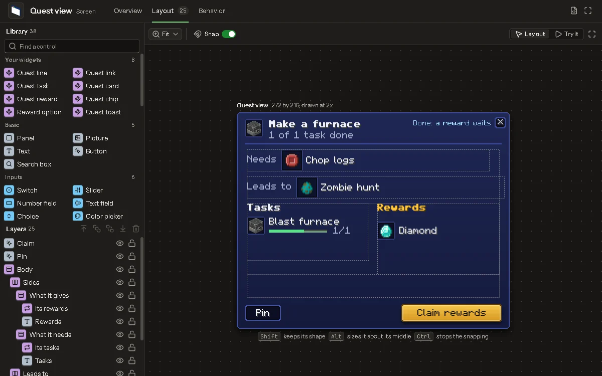

## Versions and loaders

One project builds the mod for NeoForge and Fabric on Minecraft Java Edition 1.21.1, 1.21.11, 26.1.2,
26.2 and 26.3. Screens look the same in the game as in Modryos.

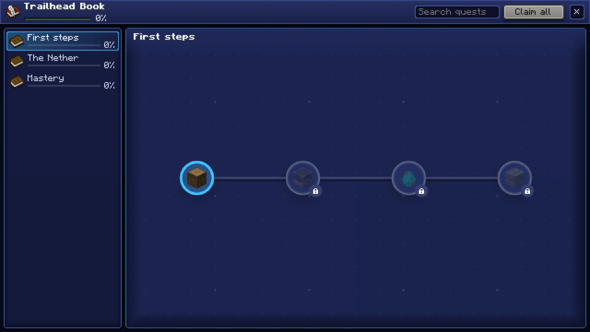

## Models, textures and animation

The model editor has a live 3D preview. Textures are painted pixel by pixel, and animations are made
on a timeline.

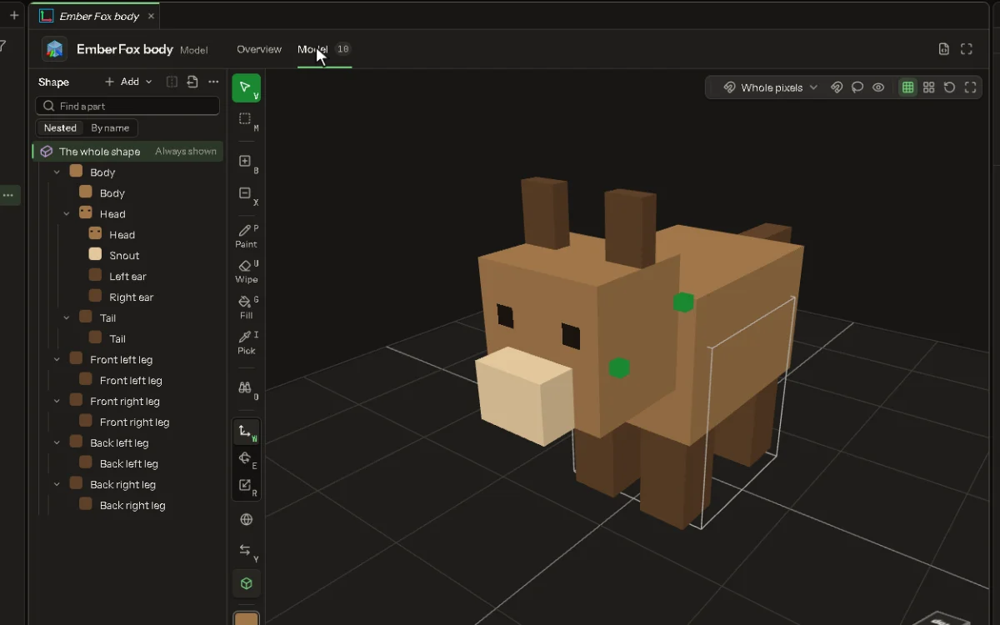

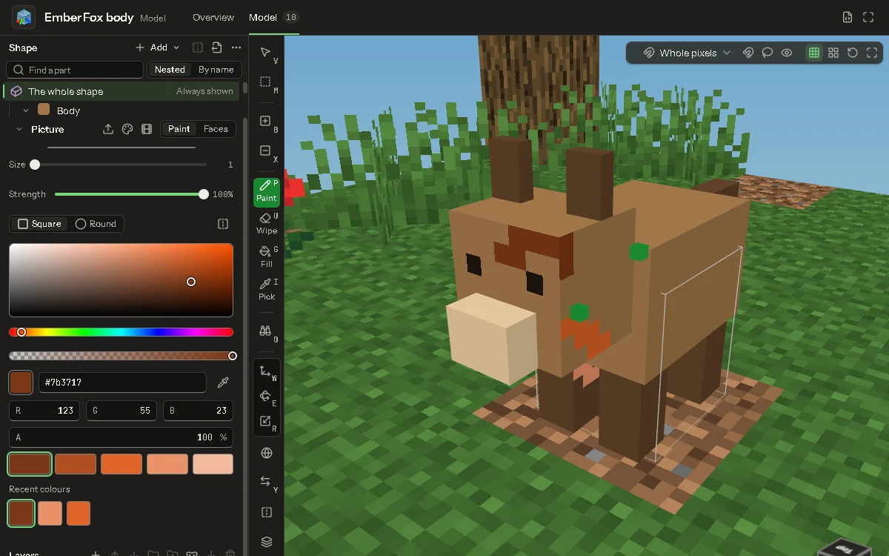

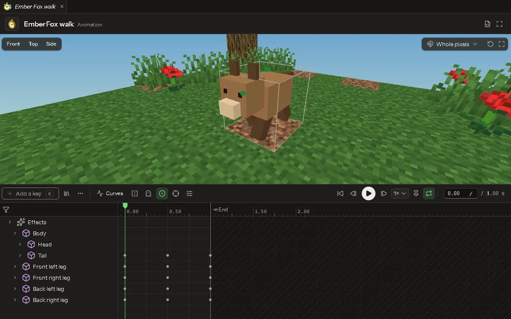

## Screens and HUD

Machine screens, HUD bars, books and quest pages are built by dragging controls onto the screen. Each
control can show data from the mod, such as a tank's level or a player's mana.

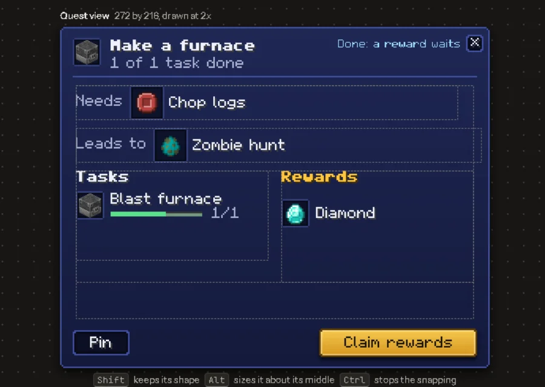

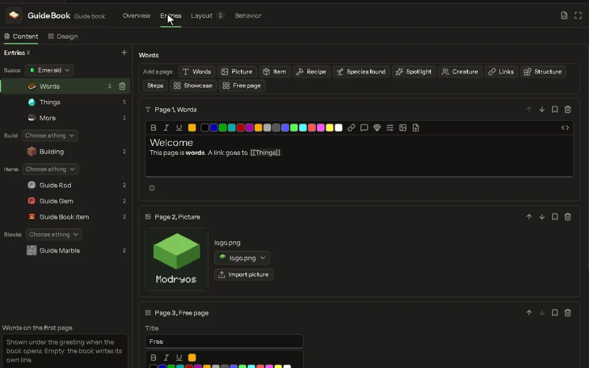

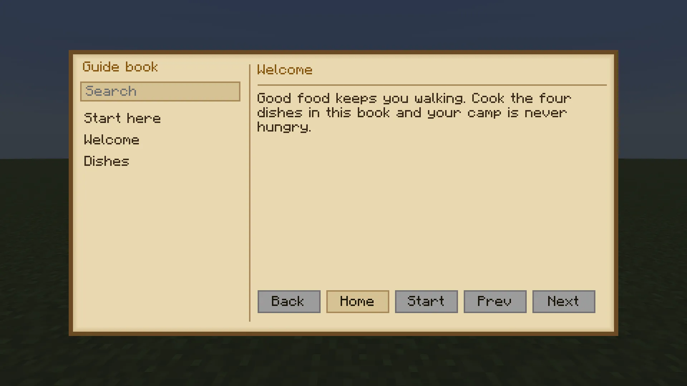

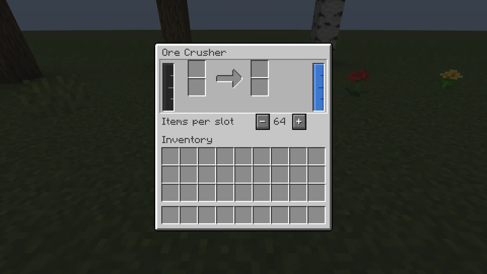

## Rules and Java

Rules are built from ready-made sentences, for example: when the sword hits something, set it on fire.
Conditions can be grouped with If, Else if and Else. Each rule is Java code underneath, and you can
open the code at any time.

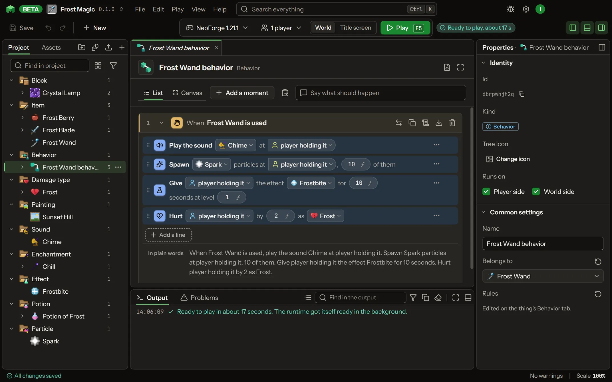

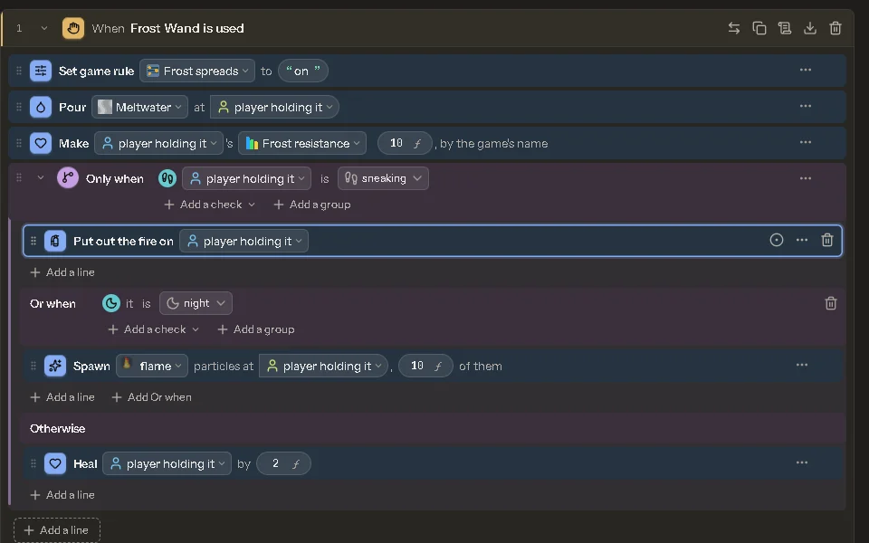

## Quests

Quests are arranged in chapters on a map.

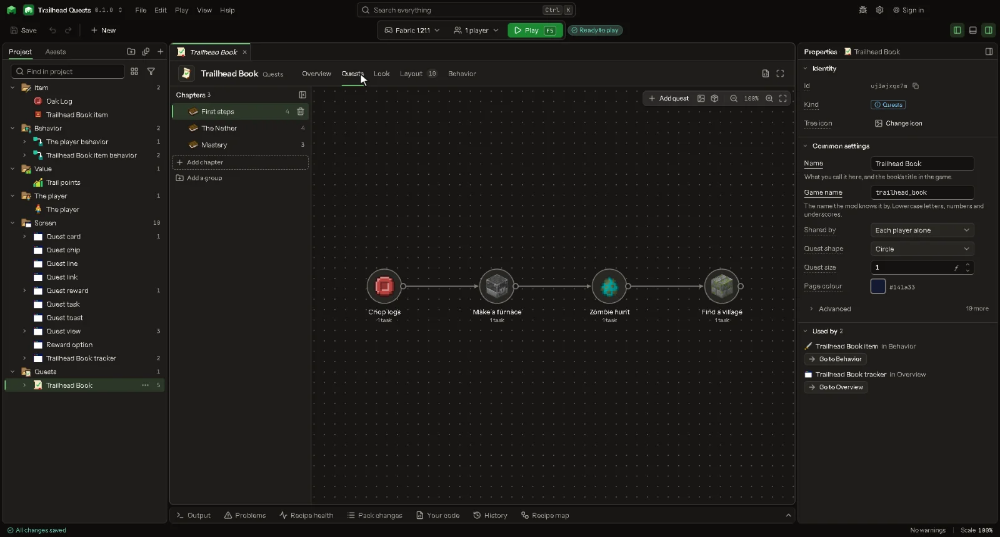

## Version history

Save a version at any time and compare two versions to see what changed.

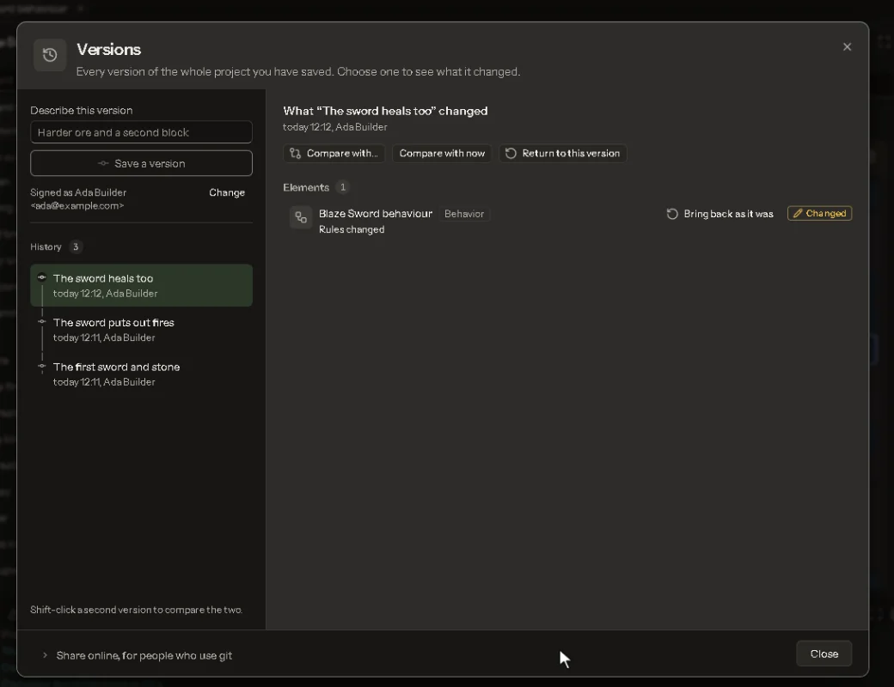

## Status

- Minecraft Java Edition 1.21.1, 1.21.11, 26.1.2, 26.2 and 26.3, on NeoForge and Fabric
- 1.0.0 is coming soon
- First mod made with Modryos: [Goat Apples](https://www.curseforge.com/minecraft/mc-mods/goat-apples) ([source](https://github.com/NeryosX/goat-apples))

## Download

Modryos is not released yet. New versions will be published on the [Releases](https://github.com/Modryos/modryos/releases) page.

## Bugs and suggestions

- [Report a bug](https://github.com/Modryos/modryos/issues/new?template=bug_report.yml)
- [Suggest a feature](https://github.com/Modryos/modryos/issues/new?template=feature_request.yml)
- Questions: [Discord](https://discord.gg/ccWxeu8BVh)

Website: [modryos.com](https://modryos.com): [features](https://modryos.com/features.html)
and [questions and answers](https://modryos.com/faq.html).

---

NOT AN OFFICIAL MINECRAFT PRODUCT. NOT APPROVED BY OR ASSOCIATED WITH MOJANG OR MICROSOFT.
