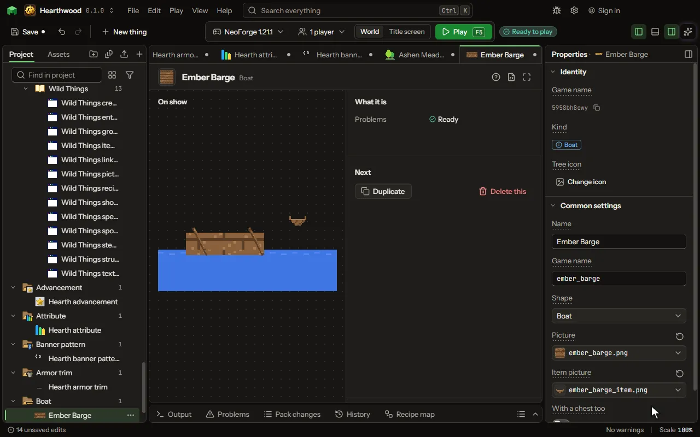

A boat or a raft a player rows on water, with a chest or not.

## How to add it

- New thing > Blocks and items > Boat

## What you can set

| Setting | What it does |
| --- | --- |
| Name | The boat's name, as its item and the game say it. |
| Game name | The boat's name in the game, as a command names it; its chest kind adds chest. |
| Shape | A boat as the game's woods have, or a flat raft as bamboo's. Choose one of: Boat, Raft. |
| Picture | The boat's wood, laid out as the game's own boat pictures are. |
| Item picture | The boat's item, held and in the inventory. |
| With a chest too | Whether it also comes with a chest in it, a boat and item of their own. |
| Chest picture | The boat with its chest, laid out as the game's chest boats are. |
| Chest item picture | The item of the boat with a chest. |

## What it becomes in the game

It is not part of the game itself: it describes another mod or a file, so it has no side to choose.

## What it works with

It does not point at other things.

## Picture

## Related pages

- [Boat](thing-boat.md)
- [Glossary](glossary.md)
