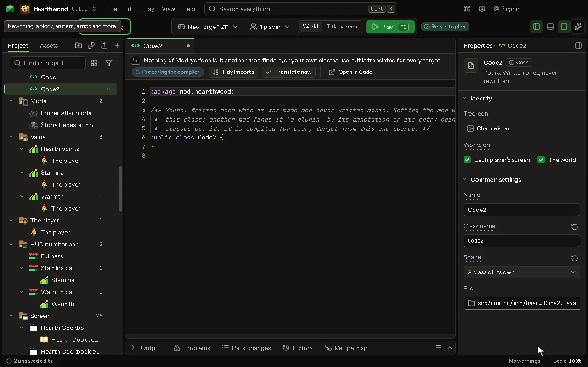

A Java class of your own, kept safe when the mod is rebuilt.

## How to add it

- New thing > Logic and code > Code

## What you can set

| Setting | What it does |
| --- | --- |
| Name | What to call this piece of code in the tree. |
| Class name | The name of your Java class. One word, starting with a capital. |
| Shape | What the sentences hand your code and what they get back. Choose one of: A mob and a number in, a number out, Nothing in, a number out, A mob in, yes or no out, A mob and the player in, nothing out, A place and the player in, nothing out, Runs every tick, Runs at the start, An item in, yes or no out, Draws on a block every frame it is seen, Thinks every tick, Poses every frame, A class of its own, A moment's own code. |
| File | Where the class lives under src. Yours; never rewritten. |
| Takes | What the method takes, as the compiler read it. |
| Gives back | What the method gives back, as the compiler read it. |
| Method | The method the sentences call. |

## What it becomes in the game

It is written into the mod when you [Cook](glossary.md#cook) or press [Play](glossary.md#play).

## What it works with

It does not point at other things.

These point at it: [Block](editor-block.md), [Mob](editor-creature.md).

## Picture

## Related pages

- [Code](thing-code.md)
- [Glossary](glossary.md)
