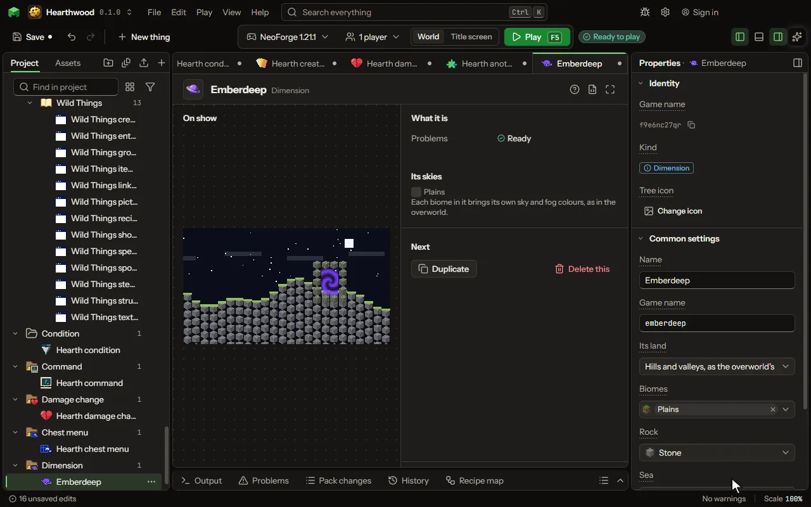

A whole other world reached through a portal.

## How to add it

- New thing > The world > Dimension

## What you can set

| Setting | What it does |
| --- | --- |
| Name | What you call it here. |
| Game name | The dimension's name in the game, as a command goes there: /execute in. |
| Its land | What its ground is like. Choose one of: Hills and valleys, as the overworld's, Shaped land, each biome its own, Islands floating in the sky, Caves under a ceiling of rock, Flat, in layers, Empty, nothing at all. |
| Biomes | The biomes it is made of, yours and the game's, each taking a share of its land. |
| Rock | The block its hills are made of, under each biome's own ground. |
| Sea | What fills its low places. Choose one of: Water, Lava, Nothing. |
| Sea level | How high its sea comes. From -64 to 256. |
| Land height | The height its land stands at; each biome stands above or below it by its own land height. From -32 to 256 blocks. |
| Hilliness | How hilly the whole dimension is; each biome's roughness is a share of it. From 0 to 100 percent. |
| Biome size | About how wide each biome's land is, in blocks. From 64 to 2048 blocks. |
| Caves | The caves cut into its ground: none, winding tunnels, or tunnels and great caverns as the overworld's. Choose one of: None, Tunnels, Tunnels and caverns. |
| Water underground | Pockets of water and lava underground at their own levels, as the overworld's; off, every cave below the sea is flooded. |
| Great ore veins | The overworld's large veins of copper and iron winding deep underground. |
| Layers | Its ground from the bottom up, each layer a block and how thick it is. Each row has: Block, Thick. |
| Time | Whether day turns to night there. Choose one of: Day and night, as the overworld, Always day, Always night. |
| Sky | What is over it. The colours of its sky and fog are its biomes'. Choose one of: A sky with the sun and the moon, No sky, a thick haze, A dark sky, as the end's. |
| Clouds | Whether clouds drift over it, under a sky with the sun and the moon. |
| Cloud height | How high its clouds drift. Before Minecraft 1.21.11 the game keeps them at its own height. From -64 to 320 blocks. |
| Light in the dark | How bright its darkest places are: none is as the overworld at night. From 0 to 100 percent. |
| Sunlight | Whether light comes down from its sky. |
| Beds work | Whether a player may sleep there. Off, a bed explodes as in the nether. |
| Distance | How far one step there carries a player elsewhere: eight is the nether's. From 0.00001 to 30000000. |
| Portal | A way in, as the nether's: a frame of a block, lit by an item. Its inside becomes a portal; standing in it takes a player there and back. |
| Frame | The block its frame is built of, two to twenty one wide and three to twenty one high inside. |
| Lit by | The item a player uses on the frame to open it. |
| Portal colour | The colour of the swirl inside the frame. |
| Settings of a made one | Numbers each dimension made from this one keeps: each starts at random between its least and its most (the same for a fixed one), and a rule may set it. Each row has: Setting, Least, Most. |
| Ore of a made one | A block scattered in veins through each made dimension's ground. None picked means none. |
| Ore veins a chunk | How many veins of the ore each chunk gets; a formula may read a setting, as ores. From 0 to 64. |
| Ore from height | The lowest the veins are. From -64 to 320. |
| Ore to height | The highest the veins are. From -64 to 320. |
| Gravity | How hard everything falls in it: 100 is the game's own, 50 half, as on a moon. From 0 to 1000 percent. |
| Monsters' strength | Monsters in it have this much of their health and their hit: 200 is twice. From 1 to 10000 percent. |
| Hurt in the dark | Hurt a second a player takes in the dark in it; 0 for none. From 0 to 1000. |
| Dark at light | The light this low or lower counts as dark: 0 is pitch black, 15 full day. From 0 to 15. |
| Air | How much air there is: 100 is the game's own; below it a player's breath runs out and they drown. From 0 to 100 percent. |
| Gives air when worn | Who wears this breathes as at home: a space helmet, a mask. |
| Gives air from | The fluid the worn item holds and breathes from. Empty: it gives air for ever. |
| Uses a second | How many millibuckets of that fluid the worn item uses each second in this dimension. When it runs out the air goes. From 0 to 100000 millibuckets. |
| Start island | Where the first one arrives in the empty, a small island is made for them. |
| Island top | The block on top of the island. |
| Island size | How far the island reaches from its middle. From 1 to 16 blocks. |
| Island height | How high the top of the island stands. 0: as before, the arrival height (64 in the overworld). Any other number is the height you choose. From -2032 to 2031 blocks. |
| Island at | Where the island is built: where the world begins (spawn), or at a place you choose. Choose one of: Where the world begins, At a place I choose. |
| Island east-west place | The x place of the island's middle. From -30000000 to 30000000. |
| Island north-south place | The z place of the island's middle. From -30000000 to 30000000. |
| Holds pocket rooms | Walled rooms, one for each name (a player, a placed block, an item), far apart in it. |
| Room walls | The block a room's six walls are made of. |
| Room's middle block | A block put in the middle of a new room's floor, as a way out. None picked means none. |
| Rooms apart | How far apart rooms are, middle to middle. From 80 to 4096 blocks. |

## What it becomes in the game

It is not part of the game itself: it describes another mod or a file, so it has no side to choose.

## What it works with

It points at: [Biome](editor-biome.md), [Block](editor-block.md).

These point at it: [World type](editor-worldType.md).

## Picture

## Related pages

- [Dimension](thing-dimension.md)
- [Glossary](glossary.md)
