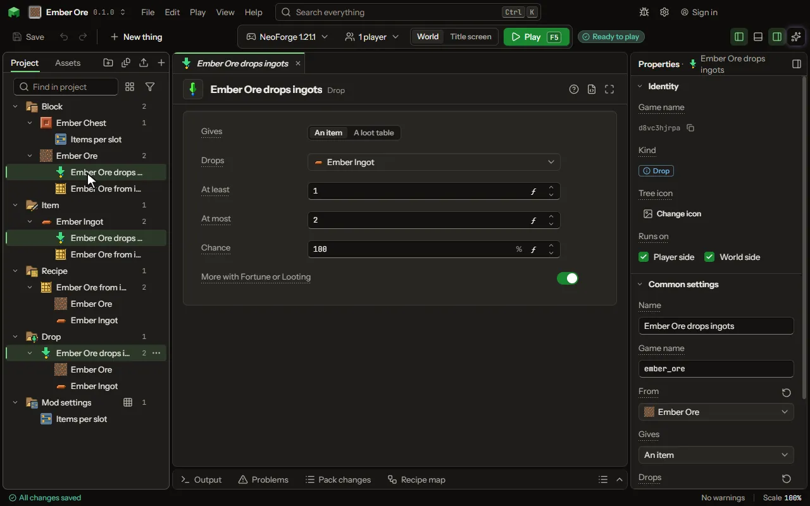

What falls out when a block breaks or a mob dies.

## How to add it

- New thing > Crafting and loot > Drop

## What you can set

| Setting | What it does |
| --- | --- |
| Name | A name for you. Players never see it. |
| Game name | The file name inside the mod. Lowercase letters, digits and underscores. |
| From | The block broken or the mob killed that gives it. |
| Or the game's | Blocks and mobs of the game or another mod that drop it too, each one or a tag of them; another mod's is typed. What they drop already stays. |
| Gives | One item, or a roll of a loot table: a crate, or a handful of anything. Choose one of: An item, A loot table. |
| Drops | What it gives. Pick one of your things or one of the game's. |
| At least | The fewest that can drop. From 0 to 64. |
| At most | The most that can drop. From 1 to 64. |
| Loot table | The loot table rolled when it drops. |
| Chance | How often it drops, out of a hundred. From 0.1 to 100 percent. |
| Only when broken with | What the block must be broken with for this to drop: shears, as grass and leaves give themselves; a Silk Touch tool, as glass does; or anything but Silk Touch, so Silk Touch takes the block itself instead. Choose one of: Anything, Shears, A Silk Touch tool, Anything but Silk Touch. |
| More with Fortune or Looting | A block broken with a Fortune pickaxe drops more, the way ores do; a creature killed with a Looting sword drops more, the way the game's mobs do. |
| Every mob of a kind | Every monster, every animal, or every mob of the water, the game's and other mods' alike. Choose one of: None, Monsters, Animals, Water mobs, Any mob. |
| Never from | Mobs it never drops from, each one or a tag of them, such as the wither or the raiders. |

## What it becomes in the game

It is written into the mod when you [Cook](glossary.md#cook) or press [Play](glossary.md#play).

## What it works with

It points at: [Block](editor-block.md), [Mob](editor-creature.md), [Loot table](editor-lootTable.md).

## Picture

## Related pages

- [Drop](thing-drop.md)
- [Glossary](glossary.md)
