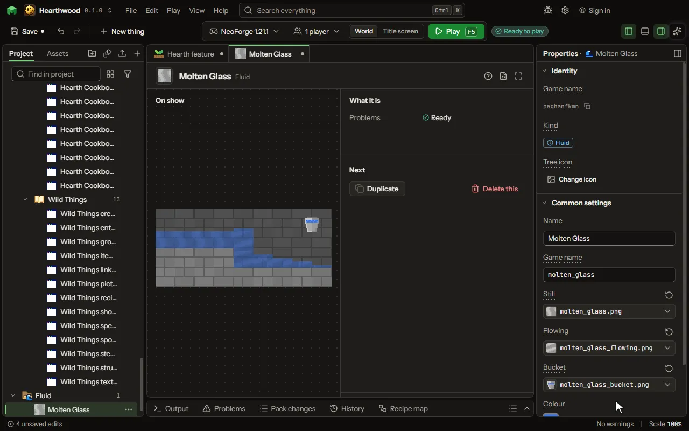

A liquid that flows in the world and fills a bucket, as water does.

## How to add it

- New thing > Machines and networks > Fluid

## What you can set

| Setting | What it does |
| --- | --- |
| Name | The fluid's name, as its bucket and the game say it. |
| Game name | The fluid's name in the game, as a command or a data pack names it; its flowing part adds flowing. |
| Still | The fluid's top where it lies still, in light greys the game tints in its colour. |
| Flowing | The fluid where it runs and falls, in the same greys. |
| Bucket | The picture of a bucket of it. |
| Colour | The colour the game tints its pictures, as water is tinted blue. |
| See through | Whether what is under and behind it shows through, as through water. |
| Like water | Whether players swim and drown in it, and it puts out fire, as water does. |
| Reaches | How far it looks for a way down before it spreads: water four, lava two. From 1 to 8 blocks. |
| Flows every | How often it flows one block further: water a quarter second, lava a second and a half. From 0.05 to 10 seconds. |
| Makes sources | Whether two of its sources make a third between them, as water does. |
| Light | How much light it gives off, from none to fifteen as lava. From 0 to 15. |

## What it becomes in the game

It is not part of the game itself: it describes another mod or a file, so it has no side to choose.

## What it works with

It does not point at other things.

These point at it: [When fluids meet](editor-fluidReactions.md).

## Picture

## Related pages

- [Fluid](thing-fluid.md)
- [Glossary](glossary.md)
