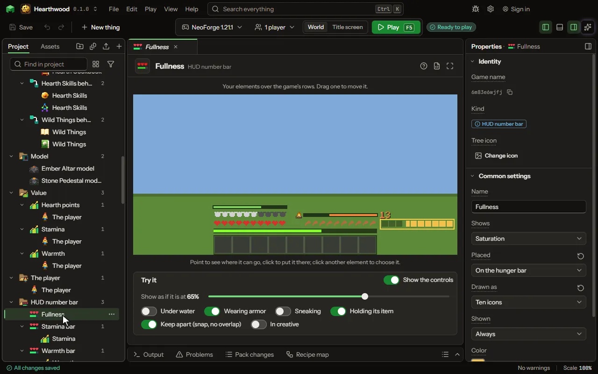

One number of the player shown over the game as a bar or words, like saturation above the hunger bar.

## How to add it

- New thing > Screens and guides > HUD number bar

## What you can set

| Setting | What it does |
| --- | --- |
| Name | What you call it here. |
| Shows | What it draws: one of the player's own numbers, a value of the player, or the block the player looks at with its readings, in a panel at the top center. Choose one of: Saturation, Hunger, Health, Air, Armor, Armor toughness, Absorption hearts, Held item's durability, Level, A value of the player, An area value where the player stands, What the player looks at. |
| Value | The value of the player it draws, against the value's most. |
| Area value | The area value it draws, where the player stands, against the value's most. |
| Placed | Where it is drawn: over the game's own icons on the hunger, health, armor or air bar; a row of its own just above the drumsticks or the hearts (higher while air bubbles or armor show there, and stacked with the others there); beside a bar, outside the hotbar; or at the top. Choose one of: On the hunger bar, On the health bar, On the armor bar, On the air bar, Above the hunger bar, Above the health bar, Beside the hunger bar, Beside the health bar, Top left, Top center, Top right. |
| Icons over the game's row | A row of icons for one of the game's rows (hunger, armour, health, air) is drawn beside it. Turn on to draw the icons over the game's own, as a saturation overlay. |
| Drawn as | A bar that fills, the number itself, ten icons as the game's own bars (two points an icon, half an icon for one), or a bar with its number. Choose one of: A bar, A number, Ten icons, A bar with its number, A veil over the screen, A veil over the sky. |
| Veil strength | How strong the tint is when the number is at its most. From 1 to 100 percent. |
| Number says | How the number reads: the number itself, the number out of its most (7/20), or a share (35%). Choose one of: The number, Out of its most, A share. |
| Shown | When it is drawn: always, while low or high, for a few seconds after it changes, while an item is held, while sneaking, or under water. Choose one of: Always, While below a share, While above a share, For a while after it changes, While holding an item, While sneaking, While under water. |
| Share | The share of its most it is compared with: shown while below it, or while above it. From 0 to 100 percent. |
| For | How long it stays after the number changes. From 1 to 60 seconds. |
| Holding | The item, or a tag of items, that shows it while held in either hand. |
| Color | The color it is drawn in. |
| Wrap into layers | A value bigger than one row starts again in the next color, as many times as it needs. |
| One row holds | How much of the value fills one row. Ten icons hold 20, two for each icon. From 1 to 1000000000. |
| Layer colors | The colors of the second row, the third and on, as color codes with spaces between. After the last one they start again. |
| Layers drawn | Over the first row, or each one above the row before. Choose one of: Over the first row, Each above the last. |
| Hide empty icons | Icons not reached are not drawn, instead of a faint dark square. |
| Recolor the game's own row | The mod draws the game's hearts or armor itself. After one full row, every further row's worth turns the row to the next color, so it never grows taller. Off keeps the game's own rows. |
| Row colors | The colors of the second row's worth, the third and on, as color codes with spaces between. After the last one they start again. |
| Icon | An item, or a picture of your own, drawn small beside it. None when empty. |
| Icon size | How big the icon is drawn, in the GUI's pixels. The usual size is 8. From 4 to 32 pixels. |
| Hidden in creative | Hidden in creative and spectator, where the game hides its own health and hunger. |
| Nudge across | Moves it right (or left, below nought) from its place, in the GUI's pixels. From -400 to 400 pixels. |
| Nudge down | Moves it down (or up, below nought) from its place, in the GUI's pixels. From -400 to 400 pixels. |

## What it becomes in the game

It is not part of the game itself: it describes another mod or a file, so it has no side to choose.

## What it works with

It points at: [Value](editor-value.md), [Area value](editor-areaValue.md).

## Picture

## Related pages

- [HUD number bar](thing-hud.md)
- [Glossary](glossary.md)
