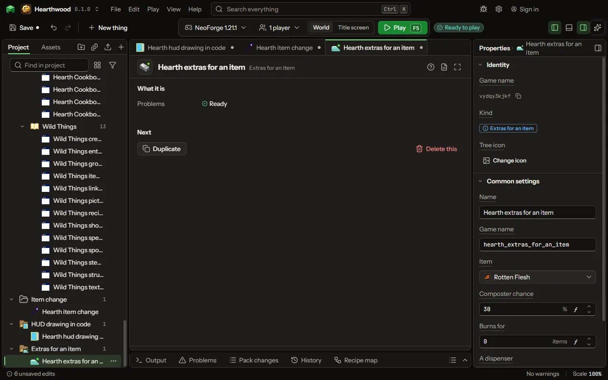

What any item, the game's or yours, also does: composts, burns in a furnace, or what a dispenser does with it.

## How to add it

- New thing > Crafting and loot > Extras for an item

## What you can set

| Setting | What it does |
| --- | --- |
| Name | What it is called here. |
| Game name | Its name inside the game, in small letters. |
| Item | The item these extras are for, the game's or yours. |
| Composter chance | The chance one put in a composter raises its level, as seeds 30, bread 85; 0 is not at all. From 0 to 100 percent. |
| Burns for | How many items one of it smelts as a furnace's fuel, as coal 8; 0 is not a fuel. From 0 to 1000 items. |
| A dispenser | What a dispenser does with it: drops it as it drops anything, places it as a block, or grows the plant in front of it as bone meal does. Choose one of: Drops it, Places it as a block, Grows plants as bone meal. |
| Stacks to | How many fit in one stack, up to 99, such as ender pearls 64; 0 keeps the game's. Items that wear out stack to 1. From 0 to 99. |
| Uses | How many uses it lasts before it breaks; 0 keeps the game's. An item given uses stacks to 1. From 0 to 100000. |
| A page in the recipe viewers | Plain lines, one per line, shown as this item's info page in the recipe viewers a player has installed. |

## What it becomes in the game

It is not part of the game itself: it describes another mod or a file, so it has no side to choose.

## What it works with

It does not point at other things.

## Picture

## Related pages

- [Extras for an item](thing-itemExtras.md)
- [Glossary](glossary.md)
