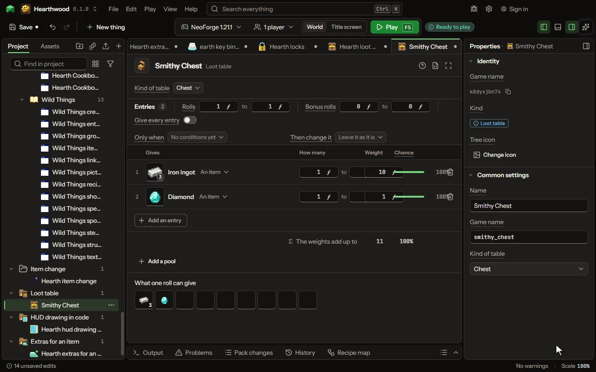

A weighted list of what can come out, rolled by a quest, a crate, a mob's or a block's drop, or a rule. It is written as the game's own, so a chest the game fills can name it too.

## How to add it

- New thing > Crafting and loot > Loot table

## What you can set

| Setting | What it does |
| --- | --- |
| Name | A name for you. Players never see it. |
| Game name | The table's name in the game, as a chest, a command or another mod names it. |
| Kind of table | What the table is for. It decides which conditions you can pick: a tool is only held when a block is broken. Choose one of: Chest, Block drops, Creature drops, Fishing, Gift, Digging up. |
| At least | How many times the list is drawn from each time the table is rolled: one number, or a range to pick from. From 0 to 64. |
| At most | How many times the list is drawn from each time the table is rolled: one number, or a range to pick from. From 0 to 64. |
| Give every entry | Every entry comes out on each roll and the weights are set aside: a bundle rather than a draw. |
| Entries | What can come out of one roll, each as likely as its weight against the others. |

## What it becomes in the game

It is not part of the game itself: it describes another mod or a file, so it has no side to choose.

## What it works with

It does not point at other things.

These point at it: [Drop](editor-drop.md), [Structure](editor-structure.md).

## Picture

## Related pages

- [Loot table](thing-lootTable.md)
- [Glossary](glossary.md)
