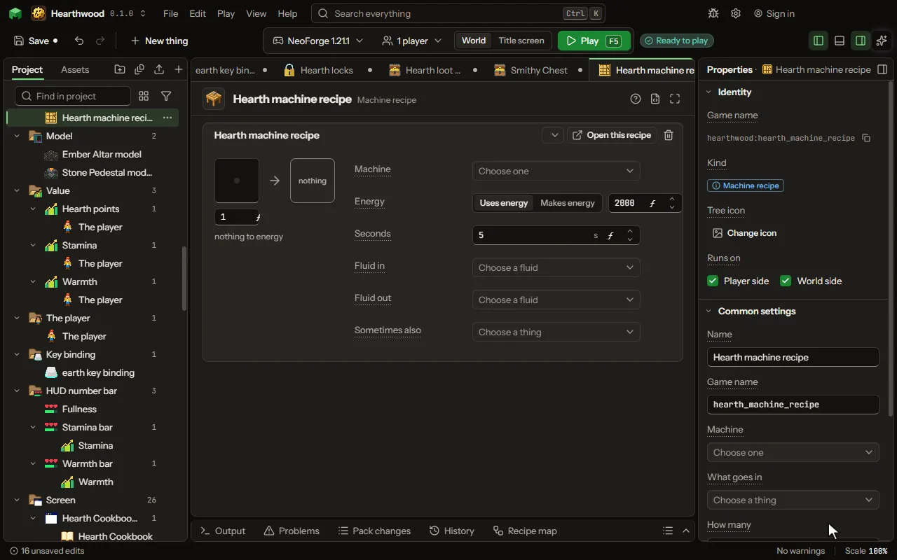

What one machine of yours turns into something else, and what it costs.

## How to add it

- New thing > Crafting and loot > Machine recipe

## What you can set

| Setting | What it does |
| --- | --- |
| Name | What you call this recipe. Leave it empty and the card names itself from what goes in and what comes out. |
| Game name | The name the game files use for this recipe. |
| Machine | The block that runs it. Recipes name their machine, so adding one changes no block. |
| What goes in | The thing the machine takes from the slots it takes from. |
| How many | How many of it one operation uses. From 1 to 64. |
| What comes out | Leave this empty for a generator: it burns what goes in to nothing. |
| How many | How many come out of one operation. From 0 to 64. |
| Second thing in | A second thing that goes in with the first, as two metals make an alloy. Leave it empty for a machine that takes one thing. |
| How many of the second | How many of the second thing one operation uses. From 1 to 64. |
| Energy | Whether the machine spends energy on this or makes it. Choose one of: Uses energy, Makes energy. |
| How much energy | Over the whole operation, not each tick. It is spread evenly across the seconds below. From 0 to 1000000000. |
| Energy each tick | Use this much energy every tick instead of the whole amount above. 0 keeps the whole amount. The recipe waits when the machine runs short. From 0 to 1000000. |
| Seconds | How long one operation takes. The game reads it while it runs, so it can come from somewhere else. From 1 to 3600 seconds. |
| Fluid in | A fluid the machine uses up each time, chosen from the list. The machine holds it in its own tank: attach Fluid to it. |
| Fluid used | How much of the fluid each time; 1000 mB is one bucket. From 1 to 1000000 millibuckets. |
| Fluid each tick | Use this much of the fluid every tick instead of all of it at the end. 0 keeps the whole amount. The recipe waits when the tank runs short. From 0 to 100000 millibuckets. |
| From tank | Which of the machine's tanks: 1 is its own, 2 and on the tanks added to it. From 1 to 5. |
| Uses a thing of your own | Matter is a thing of your own that is not an item or a fluid, like heat or mana. The machine uses this much of it each time, from what it holds: attach Matter to the machine. |
| Type | One type of the kind, by name. Left empty, the kind itself, or any of its types going in. |
| Matter used | How much of the matter each time. From 1 to 1000000000. |
| Fluid out | A fluid the machine makes each time, chosen from the list, into its own tank; it waits while there is no room. |
| Fluid made | How much of the fluid each time; 1000 mB is one bucket. From 1 to 1000000 millibuckets. |
| Into tank | Which of the machine's tanks: 1 is its own, 2 and on the tanks added to it. From 1 to 5. |
| Makes a thing of your own | A matter of your own the machine makes each time, into what it holds; it waits while there is no room. |
| Type | One type of the kind, by name. Left empty, the kind itself, or any of its types going in. |
| Matter made | How much of the matter each time. From 1 to 1000000000. |
| Makes a second thing | A second stock the machine makes each time, into a tank that takes it: water into oxygen and hydrogen. |
| Type | One type of the kind, by name. Left empty, the kind itself, or any of its types going in. |
| Matter made | How much of the matter each time. From 1 to 1000000000. |
| Sometimes also | A second thing it makes now and then beside the result, as a crusher gives a little gravel with the dust. It goes where the result goes, when there is room. |
| How many of it | How many of the second thing each time it comes. From 1 to 64. |
| Genes the result gets | What the result carries of the genes of what went in: an analyser copies and reads them, a breeder crosses two. Choose one of: None, A copy of the first's, A copy of the first's, read, The first and the second crossed, A copy of the second's, The first's, with the second's written over, One gene of the first's, at random. |
| First must show | A gene value the first thing must show to be taken, such as a species; empty takes any. |
| Of the gene | The gene that value is of; none is its species. |
| Make one for every | Writes this recipe once for everything in the set you pick: dye colours, wood types, stone types, metals, gems, or a list of your own. Where the recipe says (each) (or <colour>, <wood>, <stone>), each one's name goes; one the game lacks is left out. |
| Worked out from the inputs | What the result works out from the things the machine takes in, each by a formula: a value it holds, how many it makes, an effect and its strength, or which thing it is. The formulas see the machine too: energy, fluid and tier. Each row has: Works out, Which, Formula, Seconds. |
| How often | Out of every hundred times, how many give the second thing. From 1 to 100 percent. |
| More in and out | Any number of things more that go in or come out, beside the ones above: items, fluids or stocks of your own, each with how much and, coming out, how often. Each row has: Goes, What, Item, Fluid, Stock, Type, How much, How often, Tank. |
| Works only when | The recipe only works when this holds: at night, in a biome, in some weather, after an advancement, when a setting is on, or what is around the place it is made. Every row must hold. Each row has: When, Block, Value, Dimension, Weather, Name, Setting, At least, At most, Hours, At least, At most, Blocks away, Turned round. |
| Only while a number > 0 | For advanced rules: a number worked out where the recipe is made. The recipe works only while the number is above 0. Make it a formula to use any piece of the rules. |

## What it becomes in the game

It is written into the mod when you Cook or press Play.

## What it works with

It points at: [Block](editor-block.md), [Custom kind](editor-matter.md), [Gene](editor-gene.md), [Area value](editor-areaValue.md), [Mod settings](editor-configValue.md).

## Picture

## Related pages

- [Machine recipe](thing-machineRecipe.md)
- [Glossary](glossary.md)
