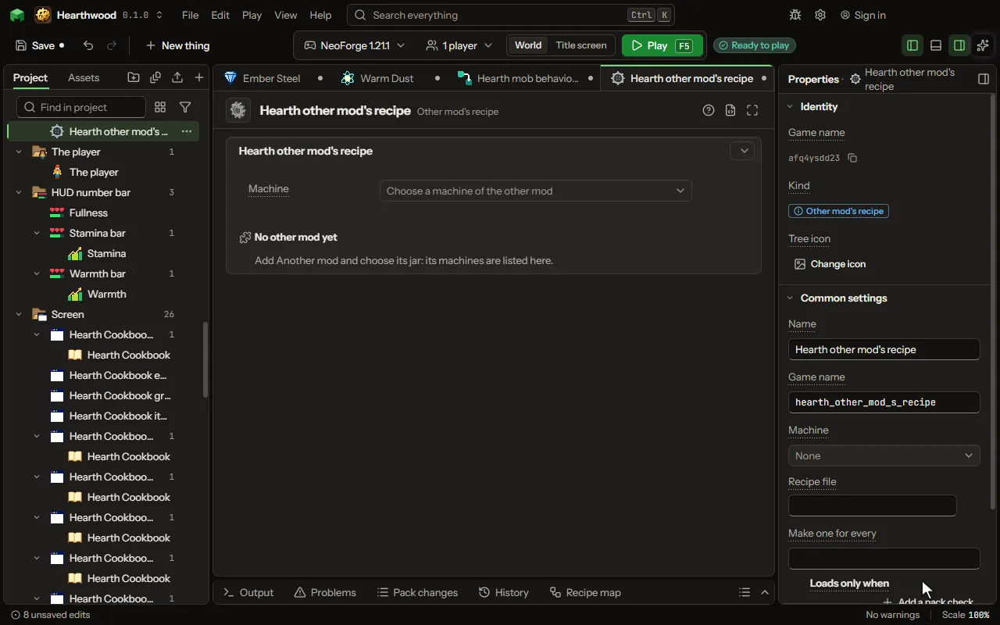

A recipe for a machine from a mod yours builds on, filled in by clicks.

## How to add it

- New thing > Crafting and loot > Other mod's recipe

## What you can set

| Setting | What it does |
| --- | --- |
| Name | A name for you. Players never see it. |
| Game name | The file name inside the mod. Lowercase letters, digits and underscores. |
| Machine | The other mod's kind of recipe, read from its jar: each machine reads its own kind. |
| Recipe file | The recipe as the other mod writes one. The holes above fill it; it can be written here too. |
| Make one for every | Writes this recipe once for everything in the set you pick: dye colours, wood types, stone types, metals, gems, or a list of your own. Where the recipe says (each) (or <colour>, <wood>, <stone>), each one's name goes; one the game lacks is left out. |
| Loads only when | Whether the recipe exists at all. It is decided once, when the game loads, so a recipe for a mod that is not there is simply left out. This is not about the moment of crafting: use Works only when for that. Each row has: The pack, Name. |
| Add its mods by itself | When the recipe uses another mod's item or tag, it is loaded only when that mod is in the pack. Turn this off to load it always. |

## What it becomes in the game

It is not part of the game itself: it describes another mod or a file, so it has no side to choose.

## What it works with

It does not point at other things.

## Picture

## Related pages

- [Other mod's recipe](thing-modRecipe.md)
- [Glossary](glossary.md)
