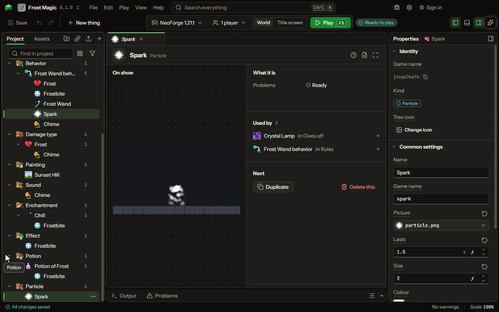

Sparks, smoke, dust and the like.

## How to add it

- New thing > Mobs and models > Particle

## What you can set

| Setting | What it does |
| --- | --- |
| Name | A name for you. Players see the particle, not its name. |
| Game name | The particle's name in the game, as /particle and another mod name it. |
| Picture | What one particle looks like; the game's own are eight pixels square. White takes the colour below as it is. |
| More pictures | Pictures after the first, shown one after another over its life or one chosen at random for each. Each row has: Picture. |
| Its pictures | Shown one after another as it ages, as smoke darkens, or one for each at random, as sparks vary. Choose one of: One after another, One at random. |
| Lasts | How long one lives before it is gone. From 0.05 to 60 seconds. |
| Size | How large, where 1 is the game's ordinary particle, a fifth of a block. From 0.1 to 10. |
| Colour | The colour its picture is tinted: white leaves it as drawn. |
| Gravity | How fast it falls: 0 floats, 1 falls as a dropped thing does, below 0 rises. From -2 to 2. |
| Spreads | How fast it drifts away from where it appears, each way at random, in blocks a second. From 0 to 20 blocksPerSecond. |
| Rises | How fast it moves up when it appears, in blocks a second; below 0 moves down. From -20 to 20 blocksPerSecond. |
| Fades | It grows fainter as it ages rather than vanishing at once. |
| Glows | It is drawn at full brightness in the dark, as a flame is. |
| Stops at blocks | It lands on and slides along blocks rather than passing through them. |

## What it becomes in the game

It is not part of the game itself: it describes another mod or a file, so it has no side to choose.

## What it works with

It does not point at other things.

These point at it: [World event](editor-worldEvent.md), [Block](editor-block.md), [Biome](editor-biome.md).

## Picture

## Related pages

- [Particle](thing-particle.md)
- [Glossary](glossary.md)
