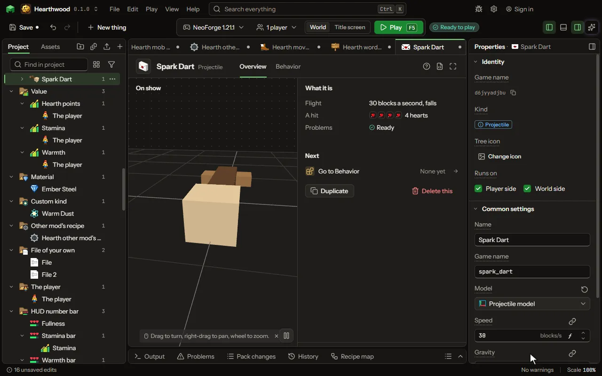

A thing that flies, drawn by a model: a spell, a dart, a boomerang, a homing missile. Shot by the shoot words and a creature's Throw move.

## How to add it

- New thing > Mobs and models > Projectile

## What you can set

| Setting | What it does |
| --- | --- |
| Name | What players see it called. |
| Game name | Its id in the game, small letters and underscores; the shoot words fire it by this. |
| Model | The model it is drawn by, made in the model editor. Its front faces where it flies. |
| Speed | How fast it leaves, in blocks a second; a snowball flies 30, an arrow from a full bow 60. It flies at this speed whatever fires it; 0 is set down where it is made, as a lit charge. From 0 to 200 blocksPerSecond. |
| Gravity | How fast it falls: 1 falls as a snowball does, 0 flies straight as a fireball, below 0 floats up as a balloon. From -10 to 10 normal. |
| Damage | How much it hurts a mob it hits, in hearts. From 0 to 1000 hearts. |
| Picture | A picture of its own in place of the one its model wears. |
| Flight animation | An animation of its model it plays over and over as it flies: wings beating, a blade turning. |
| Scale | How big its model is drawn; 1 is the model's own size. From 0.0625 to 16. |
| Spin | Turns a second about the way it flies, as a shuriken or a drill spins; 0 flies straight. From 0 to 20 perSecond. |
| Hitbox | How wide a box it hits with, in blocks. From 0.05 to 4 blocks. |
| Drag | How much of its speed the air takes each second; a snowball loses 18. From 0 to 99 percent. |
| Lifetime | How long it flies before it ends where it is, or turns back when it returns. From 0.5 to 120 seconds. |
| Knockback | How hard it pushes a mob it hits; 1 is a sword's own push. From 0 to 10. |
| Sets alight | How long a mob it hits burns; 0 sets nothing alight. From 0 to 60 seconds. |
| Pierces | How many mobs it flies through before it stops at one. From 0 to 64 times. |
| Bounces | How many times it bounces off a wall before it ends there. From 0 to 64 times. |
| When it ends | What it does where it stops: vanish, stick in the block it hit as a thrown knife does, explode, break the block, or set fire. Choose one of: Vanishes, Sticks where it lands, Explodes, Breaks the block, Sets fire. |
| Explosion | How big the explosion is; TNT is 4. From 0.5 to 10. |
| Returns | Flies back to whoever threw it after it hits or reaches its reach, as a boomerang or a yoyo, through anything on the way. |
| Reach | How far it flies out before it turns back. From 1 to 128 blocks. |
| Comes back | When it turns back: at its reach or its first hit, or only when its thrower crouches, so it stays out as a yoyo held at the end of its string. Choose one of: At its reach or a hit, When its thrower crouches. |
| Rope | A rope from its thrower: it holds it no further than its length (a yoyo, a balloon on a string), pulls the thrower to where it sticks (a grappling hook), or pulls the mob it hits back to the thrower (a harpoon). Crouching lets go. Choose one of: No rope, Holds it at its length, Pulls its thrower to where it sticks, Pulls the mob it hits to its thrower. |
| Rope length | How long its rope is; past it, it is held back, or a hook that has not caught comes back. From 1 to 128 blocks. |
| Pull | How fast its rope pulls, in blocks a second. From 1 to 100 blocksPerSecond. |
| Rope colour | The colour its rope is drawn in. |
| Breaks blocks | How many blocks it breaks and flies on through, as a pickarang or a drill; 0 stops at the first. With Returns it turns back after the last. From 0 to 64 times. |
| Breaks up to | The hardest block it breaks: dirt is 0.5, stone 1.5, obsidian 50. A harder one stops it. From 0 to 100. |
| Collects items | Picks up the dropped items it touches and gives them to its thrower when it comes back, or drops them where it ends. |
| Homing | How hard it turns toward its target each tick: what its thrower fights, or the nearest mob. 0 flies where it was aimed. From 0 to 100 percent. |
| Homing reach | How far it looks for a target. From 1 to 64 blocks. |
| Turns toward | What it homes on: the nearest mob (or what its thrower fights), only what its thrower fights or last hurt, or where its thrower looks, steered as a guided missile. Choose one of: The nearest mob, What its thrower fights, Where its thrower looks. |
| Comes down on | Flies its own way to a place and comes down on it: where its thrower looks, or on what its thrower fights (the nearest mob otherwise). Nothing: it flies as thrown. Choose one of: Nothing, flies as thrown, Where its thrower looks, What its thrower fights. |
| Arc height | How high its arc climbs on the way, in blocks. 0 flies straight there without falling. From 0 to 128 blocks. |
| Splits into how many | How many it splits into, fanned out evenly, like a cluster shell or a firework's stars. 0 never splits. From 0 to 32 times. |
| Pieces | Which of your projectiles it splits into. Empty: smaller copies of itself that do not split again. |
| Splits when | Where it lands, at the top of its arc as it starts to fall, or after a time of flying. Choose one of: It lands, At the top of its arc, After a time. |
| Splits after | How long it flies before it splits. From 0.05 to 60 seconds. |
| Split spread | How wide the split pieces fan out, in degrees. From 0 to 180 degrees. |
| Holds what it hits | Sticks on the mob it hits and stays on it, slowing it, like an ice cube or a sticky bomb; at Slows 0 it only rides along, like a tracker. |
| Holds for | How long it stays on the mob. Then it ends there, with its Last hit and its When it lands. From 0.05 to 600 seconds. |
| Slows by | How much slower the mob it holds moves. 100 holds it still. From 0 to 100 percent. |
| Carries | An item, block or mob it carries and lets out where it ends. Empty carries nothing. |
| How many it carries | How many of what it carries. From 0 to 64 times. |
| Lets it out as | Dropped as items, placed as blocks, or let out as mobs where it ends. Choose one of: Items, Blocks, Mobs. |
| Fuse range | It goes off this close to what sets it off, without hitting it. 0 has no fuse. From 0 to 16 blocks. |
| Fuse goes off near | What sets the fuse off: any mob, monsters, players, or a block of a kind. Choose one of: Any mob, Monsters, Players, A block of a kind. |
| Fuse block | The block or block tag that sets the fuse off. |
| Takes from what fired it | A stat of the weapon or ammunition that fired it goes into one of its numbers: a bolt hurts as its material does. Each row has: From its, Into its, How, Share. |
| Ammunition item | The item a weapon uses up to fire it with the Shoot ammunition line: a bullet, a shell, a bolt, or a #tag of them. |
| Trail | The particles it leaves behind it as it flies. Choose one of: None, Flame, Smoke, Heart, Crit, Portal, Happy, Soul, Snow, Enchanting letters, Music notes, Angry clouds, White clouds, Bubbles, A witch's sparkle, A totem's burst, A sword's sweep, End rod sparks, Glow squid light, Wax flecks, Electric sparks, Sculk souls, Water drops. |
| Hit sound | The sound it makes when it hits a mob or a block. Choose one of: None, Fire crackle, Thunder, Explosion, Anvil, Bell, Level up, Hurt, Pop, A door opening, A chest opening, Experience picked up, A button click, A villager agreeing, A villager refusing, An enderman's teleport, A portal's hum, A splash, Eating, A burp, The wither's arrival, The dragon's growl, A totem saving a life, An amethyst chime, A harp note. |

## What it becomes in the game

It is added to the game, so a player needs your mod to see it.

## What it works with

It points at: [Model](editor-model.md), [Animation](editor-animation.md).

These point at it: [Behavior](editor-behaviour.md), [Spell](editor-spell.md).

## Picture

## Related pages

- [Projectile](thing-projectile.md)
- [Glossary](glossary.md)
