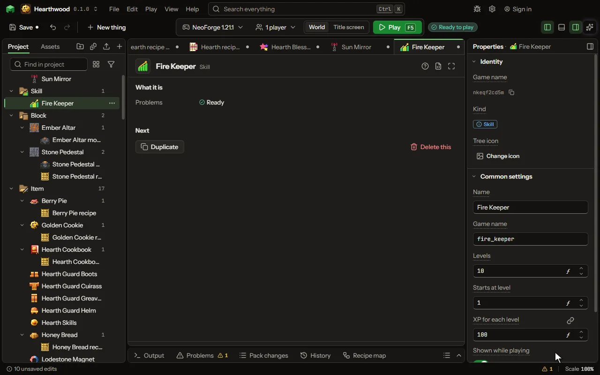

A skill with levels, like Mining or Farming: XP comes from any moment, each level reached runs its rewards, and locks may wait for a level.

## How to add it

- New thing > Screens and guides > Skill

## What you can set

| Setting | What it does |
| --- | --- |
| Name | The skill's name, shown on the screen while playing. |
| Game name | Its name in the game and in rules. |
| Levels | The highest level the skill reaches. From 1 to 100000. |
| Starts at level | The level every player has before any XP. From 0 to 100000. |
| XP for each level | The XP it takes to go from a level to the next; a formula may read the level, as 50 * the level. From 1 to 100000000. |
| Shown while playing | Its name, level and a bar of XP at the top left of the screen. |
| Kept after dying | Off, a death starts the skill again from its first level. |

## What it becomes in the game

It is not part of the game itself: it describes another mod or a file, so it has no side to choose.

## What it works with

It does not point at other things.

## Picture

## Related pages

- [Skill](thing-skill.md)
- [Glossary](glossary.md)
