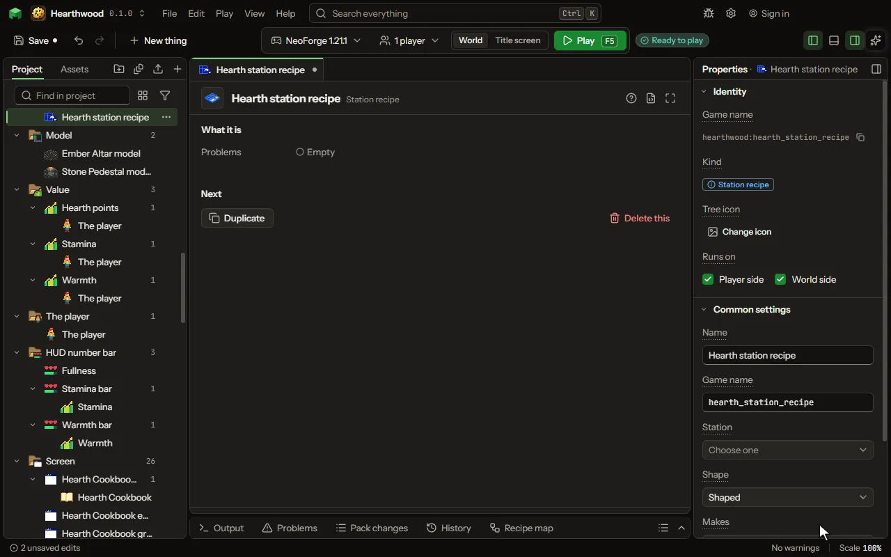

A recipe done on a station's own screen, with cells, tanks and energy.

## How to add it

- New thing > Crafting and loot > Station recipe

## What you can set

| Setting | What it does |
| --- | --- |
| Name | What you call this recipe. |
| Game name | The name the game files use for this recipe. |
| Station | The block whose screen it fills. Its Slot groups give the cells. |
| Shape | Shaped matches the pattern anywhere in a group; shapeless any cells. Choose one of: Shaped, Shapeless. |
| Cells | What each cell of the station's screen holds, by the cell's name. Each row has: Cell, Slot. |
| Makes | What comes out of the crafting table. |
| How many | How many come out each time. From 1 to 64. |
| How often | Out of every hundred times the recipe runs, how many give its result. A hundred: every time. From 1 to 100 percent. |
| Seconds | 0 crafts when the result is taken, as a crafting table does. From 0 to 3600 seconds. |
| How much energy | Energy it uses over the whole craft; 0 for none. From 0 to 1000000000. |
| Fluid in | A fluid it uses up from a tank, chosen from the list. |
| Fluid used | How much of the fluid each time; 1000 mB is one bucket. From 1 to 1000000 millibuckets. |
| From tank | Which of the machine's tanks: 1 is its own, 2 and on the tanks added to it. From 1 to 5. |
| Make one for every | Writes this recipe once for everything in the set you pick: dye colours, wood types, stone types, metals, gems, or a list of your own. Where the recipe says (each) (or <colour>, <wood>, <stone>), each one's name goes; one the game lacks is left out. |
| Worked out from the inputs | What the result works out from the things in the cells, each by a formula: a value it holds, how many it makes, an effect and its strength, or which thing it is. Each row has: Works out, Which, Formula, Seconds. |
| Fluid out | A fluid it makes into a tank, chosen from the list. |
| Fluid made | How much of the fluid each time; 1000 mB is one bucket. From 1 to 1000000 millibuckets. |
| Into tank | Which of the machine's tanks: 1 is its own, 2 and on the tanks added to it. From 1 to 5. |
| More in and out | Any number of things more that go in or come out, beside the ones above: items, fluids or stocks of your own, each with how much and, coming out, how often. Each row has: Goes, What, Item, Fluid, Stock, Type, How much, How often, Tank. |
| Works only when | The recipe only works when this holds: at night, in a biome, in some weather, after an advancement, when a setting is on, or what is around the place it is made. Every row must hold. Each row has: When, Block, Value, Dimension, Weather, Name, Setting, At least, At most, Hours, At least, At most, Blocks away, Turned round. |
| Only while a number > 0 | For advanced rules: a number worked out where the recipe is made. The recipe works only while the number is above 0. Make it a formula to use any piece of the rules. |
| Loads only when | Whether the recipe exists at all. It is decided once, when the game loads, so a recipe for a mod that is not there is simply left out. This is not about the moment of crafting: use Works only when for that. Each row has: The pack, Name. |
| Add its mods by itself | When the recipe uses another mod's item or tag, it is loaded only when that mod is in the pack. Turn this off to load it always. |

## What it becomes in the game

It is written into the mod when you Cook or press Play.

## What it works with

It points at: [Block](editor-block.md), [Custom kind](editor-matter.md), [Area value](editor-areaValue.md), [Mod settings](editor-configValue.md).

## Picture

## Related pages

- [Station recipe](thing-stationRecipe.md)
- [Glossary](glossary.md)
