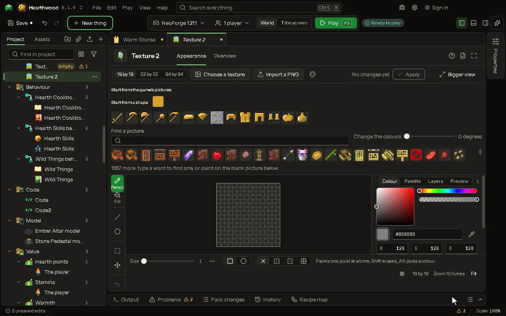

The pixels a block, item or mob wears.

## How to add it

- New thing > Mobs and models > Texture

## What you can set

| Setting | What it does |
| --- | --- |
| Name | What you call this picture. |
| Replaces | The game's id for the texture this stands in for, like minecraft:block/stone. |
| Texture | The picture that replaces it. |

## What it becomes in the game

It is written into the mod when you Cook or press Play.

## What it works with

It does not point at other things.

## Picture

## Related pages

- [Texture](thing-texture.md)
- [Glossary](glossary.md)
