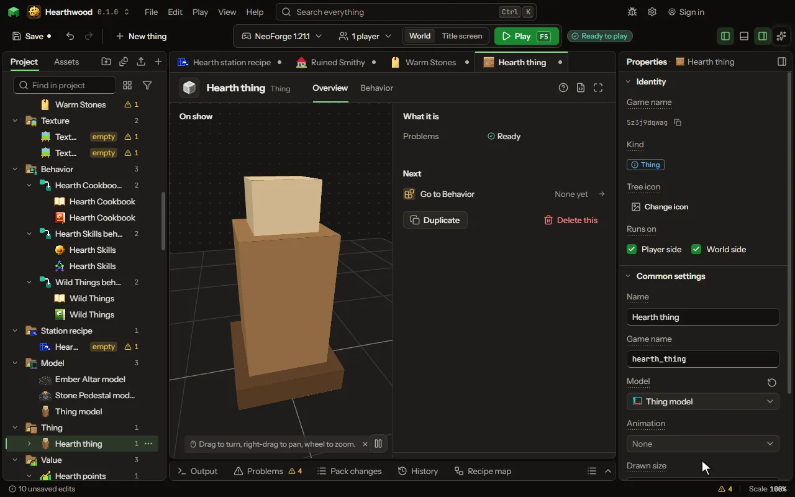

Something in the world that is not a mob and does not fly: a spell's ward, a frame on a wall, a floating orb, a balloon on a string, a trap. Made by a rule word, drawn by a model.

## How to add it

- New thing > Mobs and models > Thing

## What you can set

| Setting | What it does |
| --- | --- |
| Name | What players read above it, in any words: spaces and capitals are fine, like "Ruby Blade of Sam". The Game name is the short name the game uses instead. |
| Game name | The short name the game and its commands use: small letters, digits and underscores, like katana. In commands and recipes the mod's short name and a colon go in front: for a mod called rubygear, katana is written rubygear, a colon, then katana. Players never read it; that is the Name. Change it later and it is renamed everywhere. |
| Model | The model it is drawn by, made in the model editor. Its front faces out of a wall it hangs on. |
| Animation | A clip it plays over and over as it stands. |
| Picture | A picture it wears in place of its model's own. |
| Drawn size | How big its model is drawn: 1 is the model's own size. From 0.0625 to 16. |
| Spin | How many turns a second it spins as it stands. From 0 to 20 perSecond. |
| Width | How wide it is, in blocks: what can be hit and what it bumps into. From 0.05 to 16 blocks. |
| Height | How tall it is, in blocks. From 0.05 to 16 blocks. |
| When walked into | Walked through, stood on and bumped into like a block, or pushed along. Choose one of: Walked through, Solid, Pushed along. |
| Stays for | How long it stays before it ends by itself. 0 stays until it is broken. From 0 to 3600 seconds. |
| Kept with the world | When on, it is still there after the world is saved and opened again. |
| Breaks after | How much it takes from hits before it breaks. 0 never breaks from hits (a player in creative still breaks it). From 0 to 1000 hearts. |
| Where it hangs | Where it is made (in the air), flat on the face of a block, or beside the one who made it. Choose one of: Where it is made, On a block's face, Beside its owner, Pinned to a block, On top of a block. |
| Fall | How fast it falls when it hangs nowhere. 0 floats in place; below 0 rises like a balloon. From -10 to 10 normal. |
| Height over its owner | How far above the one who made it it keeps. From -4 to 8 blocks. |
| Tied to its owner | A rope ties it to the one who made it, as a balloon on a string or a mob on a chain. |
| Rope colour | The colour its rope is drawn in. |
| Rope length | How far it can be from its owner before the rope pulls it back. From 1 to 32 blocks. |
| Rope pulls | Which way the rope pulls: it toward its owner (a balloon), or its owner back to it (a chained mob, a mob on a leash). Choose one of: It to its owner, Its owner to it. |
| Area | How far round it reaches, in blocks: the mobs inside are touched so often. 0 has no area. From 0 to 32 blocks. |
| How often | How often its Every time and Touches moments run. From 0.05 to 60 seconds. |
| Touches | Whom its area touches. Choose one of: Every mob but its owner, Only monsters, Only players, Every one. |
| Particles | Particles it gives off as it stands, spread over its area. Choose one of: None, Flame, Smoke, Heart, Crit, Portal, Happy, Soul, Snow, Enchanting letters, Music notes, Angry clouds, White clouds, Bubbles, A witch's sparkle, A totem's burst, A sword's sweep, End rod sparks, Glow squid light, Wax flecks, Electric sparks, Sculk souls, Water drops. |
| Holds an item | A player puts an item in by using it and takes it out with an empty hand; it shows the item and drops it when it breaks. |
| Grows to | How many times its drawn size it grows to over its growing time, like a crystal. 1 does not grow. From 0.1 to 16 times. |
| Growing time | How long it takes to grow to full size. Its When it is grown runs then. From 0.05 to 3600 seconds. |
| Its box grows too | As it grows, the box that can be hit, touched and stood against grows with its drawing, so a crystal grown to twice its size is twice as tall to the game as well as to the eye. Off, the box stays its first size. |
| Sticks to what it touches | It clings to a mob or a player that touches it and goes along with them, like an ice cube or a web. Choose one of: Nothing, Mobs, Players, Mobs and players. |
| Slows it by | How much it slows what it sticks to, in percent. From 0 to 100 percent. |
| Lets go after | Seconds before it lets go. 0 never lets go (until what it sticks to dies). From 0 to 600 seconds. |
| Joins others of its kind | Two of the same kind that touch become one. The new one is as big as both added, up to what it grows to. |
| Hurt only by | anything, nothing, or a list split by commas of damage kinds (magic, fire, explosion, projectile, player) or damage type game names. |
| Health | How much damage it takes before it breaks, when only some things hurt it. Its Breaks after number wins when that is set. From 0.5 to 1000 hearts. |
| Fire-proof | Fire and lava do not hurt or burn it. |
| Glows | Drawn at full light, even in the dark. |

## What it becomes in the game

It is added to the game, so a player needs your mod to see it.

## What it works with

It points at: [Model](editor-model.md), [Animation](editor-animation.md).

These point at it: [Behavior](editor-behaviour.md).

## Picture

## Related pages

- [Thing](thing-thing.md)
- [Glossary](glossary.md)
