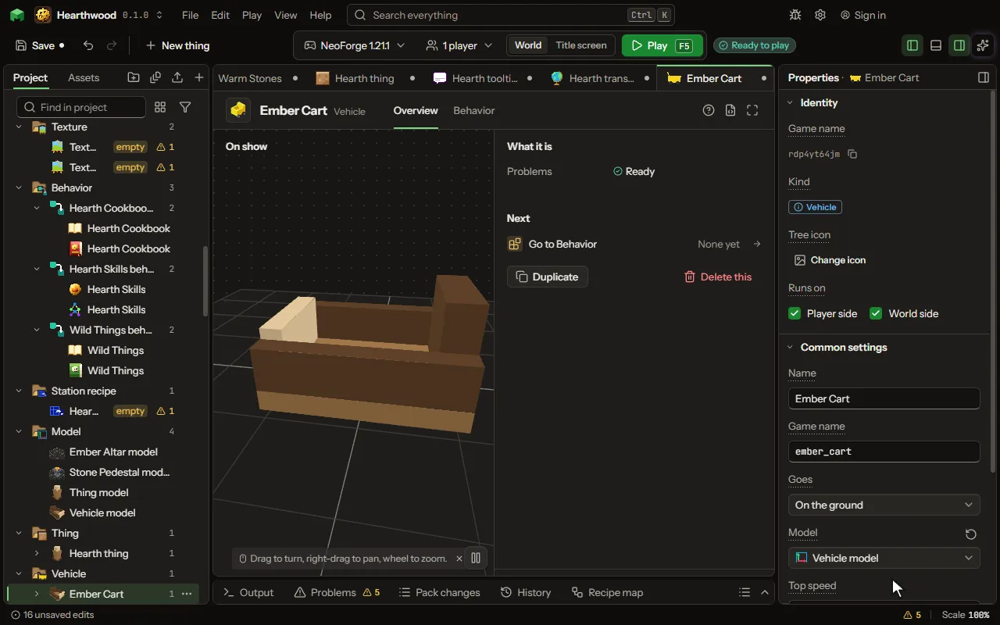

Something to ride that is not alive, beyond the boat: a cart, a motor boat, a broom or an airship, a minecart of its own, a ride along a path. Steered with the game's own keys, with seats, fuel, cargo and parts.

## How to add it

- New thing > Blocks and items > Vehicle

## What you can set

| Setting | What it does |
| --- | --- |
| Name | What players see it called. |
| Game name | The name the game knows it by, in small letters. |
| Goes | How it goes: on the ground, on water, in the air, on the game's rails, or along a path of blocks with its riders inside. Choose one of: On the ground, On water, In the air, On rails, Along a path. |
| Looks like | The game's own minecart, with a block in it, or a model of its own. Choose one of: The game's minecart, Its own model. |
| Block in the cart | A block drawn inside the cart, by its game name, as a chest or a furnace in the game's own carts. Empty shows none. |
| Model | The model it is drawn by, made in the model editor. Its front is the way it goes. |
| Animation | A clip it plays over and over. |
| Picture | A picture it wears in place of its model's own. |
| Drawn size | How big its model is drawn: 1 is the model's own size. From 0.0625 to 16. |
| Width | How wide it is, in blocks: what can be hit and what it bumps into. From 0.2 to 8 blocks. |
| Height | How tall it is, in blocks. From 0.1 to 8 blocks. |
| Top speed | How fast it goes at most, in blocks a second. A horse runs about 10, a boat about 8. From 0 to 60 blocksPerSecond. |
| Time to top speed | How many seconds it takes to get to its top speed, and to stop again with nothing pressed. From 0.05 to 30 seconds. |
| Turn | How fast A and D turn it, in degrees a second. From 0 to 720 degreesPerSecond. |
| Climb | How fast it rises with the jump key and sinks with the sprint key, in blocks a second. From 0 to 40 blocksPerSecond. |
| Flies by | How it flies: hovering (a broom, a drone: the jump key rises, the sprint key sinks), on wings (a plane: its speed lifts it, it banks to turn and glides without power), or by thrust (a rocket: its engine against its weight). Choose one of: Hovering, Wings, Thrust. |
| Holds its height | When on, it stays at its height with nothing pressed; when off, it glides slowly down. |
| Take-off speed | How fast it must go before its wings lift it, in blocks a second. Slower in the air, it stalls and drops its nose. From 0 to 60 blocksPerSecond. |
| Glide | With no power, how many blocks forward it goes for each block down. From 1 to 60. |
| Most roll | How far A and D bank it, in degrees. The more it banks, the faster it turns. From 0 to 90 degrees. |
| Thrust | How hard its engine pushes up while the jump key fires it. More thrust than weight lifts it; a rule may set it from its engine blocks. From 0 to 100000. |
| Weight | How heavy it is against its thrust. A rule may set it from the blocks it is built of. From 0.01 to 100000. |
| Lands by | How it comes down: its engine brakes it near the ground, a parachute slows its fall, or nothing slows it. Choose one of: A landing burn, A parachute, Nothing. |
| Leaves the world at | The height at which it leaves for another world, its riders with it. 0 never leaves. From -64 to 4000 blocks. |
| Arrives in | The world it arrives in, by its game name: the End, the Nether, a world of the mod's own. Empty arrives over the same place in this world. |
| Arrives at height | How high it arrives over the same place, in blocks; from there it comes down. From -64 to 4000 blocks. |
| Gravity | How hard the world pulls it down, against the game's own pull: 1 is the game's, 0 floats. From 0 to 10 normal. |
| Drag | How much of its speed it loses each second with nothing pushing it: none coasts on, all stops at once. From 0 to 1. |
| Dives | Under water it goes down with the sprint key and up with the jump key, and holds its depth with neither, as a submarine. |
| Speed on land | Its share of its speed out of the water: a little for a boat, all of it for an amphibious one. From 0 to 1. |
| Also on water | It floats and drives on water too, as an amphibious car. |
| Boost | How many times faster it goes while the sprint key is held, spending fuel as fast. 1 has no boost. From 1 to 5 normal. |
| Steps up | How high a step it drives up without a jump, in blocks. From 0 to 4 blocks. |
| Steering | How its driver steers: by how it goes (where the driver looks in the air, A and D on the ground and water), A and D turn it, or it goes where the driver looks. Choose one of: By how it goes, A and D turn it, Where the driver looks. |
| Path of | The block it follows, by its game name, or a tag after a #. It goes straight on, turns where the line turns, takes the side its rider looks to where the line splits, and stops at the end. |
| Drives itself | When on, it runs along the rails by itself while it has fuel, as the game's furnace cart; when off, only with a rider. |
| Seats | How many can ride it. The first one on drives. From 1 to 8. |
| Riders unseen | Its riders are not seen while they ride, as when carried inside a pipe. |
| Seat height | How high its riders sit above its bottom, in blocks. From -2 to 6 blocks. |
| Fuel | What it needs to go: nothing, items put in, a fluid by the bucket, or whatever its rules give it. Empty, it stops. Choose one of: Nothing, Items put in, A fluid, What its rules give. |
| Fuel item | The item it burns, by its game name, or a tag after a #. Used on it, or kept in its cargo, it fills it. |
| Fuel fluid | The fluid it runs on, by its game name. A bucket of it used on it fills it, and the bucket comes back empty. |
| Fuel it holds | The most fuel it holds. From 1 to 1000000. |
| Fuel from one | How much fuel one item or one bucket gives. From 0 to 1000000. |
| Fuel used | How much fuel a second of going takes. Standing still takes none; holding its height in the air does. From 0 to 100000 perSecond. |
| Stops when empty | When on, it cannot go with no fuel left; when off, fuel only counts. |
| Cargo | Rows of nine slots it carries, opened by crouching and using it. 0 carries nothing. From 0 to 6. |
| Tank | How much fluid it carries, in millibuckets (1000 is one bucket). A block beside the rail that moves fluid by itself fills it or empties it. 0 carries none. From 0 to 1000000 millibuckets. |
| Tank takes | The fluids its tank takes, each by its game name (water, lava). Empty: any fluid, one at a time. |
| Battery | How much energy it carries. A block beside the rail that moves energy by itself charges it or drains it. 0 carries none. From 0 to 100000000. |
| Machine it carries | A block of your mod with its own slots and recipes that works inside the cart while the cart moves (a furnace cart, an apiary cart). Its slots are reached by a block that moves by itself beside the cart, and they drop when the cart breaks. |
| Part slots | How many parts a player can put in by using a part on it. From 0 to 8. |
| Built-in parts | Parts it always has, by their game names with commas between: a chest, a drill, a light. |
| Breaks after | How much it takes from hits before it breaks and drops its item, its cargo and its parts. 0 never breaks from hits. From 0 to 1000 hearts. |
| Its item | The item it drops when it breaks, and gives back when it packs up. |
| When left | What happens when its last rider gets off: it stays, or it packs up into its item in the rider's hands, as a broom. Choose one of: It stays, It packs up. |
| Sound while going | A sound it makes once a second while it goes, by its game name: an engine, wings, a rattle. |
| Sound standing | A sound it makes once a second with a driver while it stands, by its game name: an engine running slowly. |
| Sound boosting | A sound it makes once a second while it boosts, by its game name. |
| Lit | When it is drawn at full light, even in the dark: never, while it runs, or always. Choose one of: Never, While it runs, Always. |
| Hurts what it hits | How much a mob it runs into at full speed is hurt, and it is thrown aside; slower, less. 0 hurts nothing. From 0 to 100 hearts. |
| How often | How often its While it runs moment runs. From 0.05 to 60 seconds. |

## What it becomes in the game

It is added to the game, so a player needs your mod to see it.

## What it works with

It points at: [Model](editor-model.md), [Animation](editor-animation.md), [Block](editor-block.md), [Item](editor-item.md).

These point at it: [Behavior](editor-behaviour.md).

## Picture

## Related pages

- [Vehicle](thing-vehicle.md)
- [Glossary](glossary.md)
