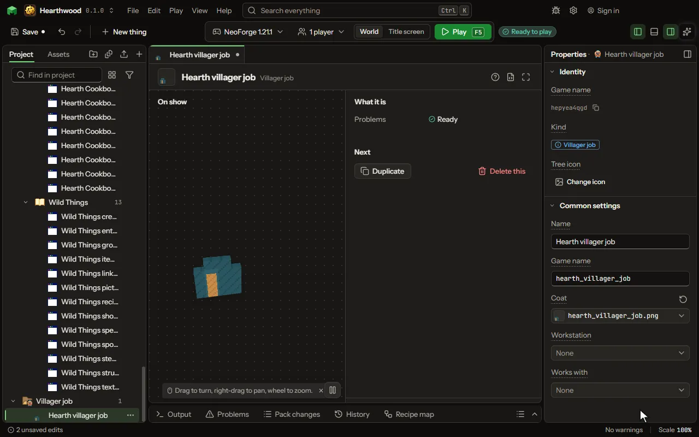

A job a villager takes at its workstation, with its coat and its trades.

## How to add it

- New thing > Mobs and models > Villager job

## What you can set

| Setting | What it does |
| --- | --- |
| Name | The job's name, as the trading screen shows it. |
| Game name | The job's name in the game, as a command or a data pack names it. |
| Coat | What a villager with the job wears over its robe. |
| Workstation | The block a villager takes the job at. A block of the game's job may not be used again. |
| Works with | The sound a villager makes as it works at its workstation. |

## What it becomes in the game

It is not part of the game itself: it describes another mod or a file, so it has no side to choose.

## What it works with

It points at: [Block](editor-block.md), [Sound](editor-sound.md).

These point at it: [Villager trade](editor-villagerTrade.md).

## Picture

## Related pages

- [Villager job](thing-villagerProfession.md)
- [Glossary](glossary.md)
