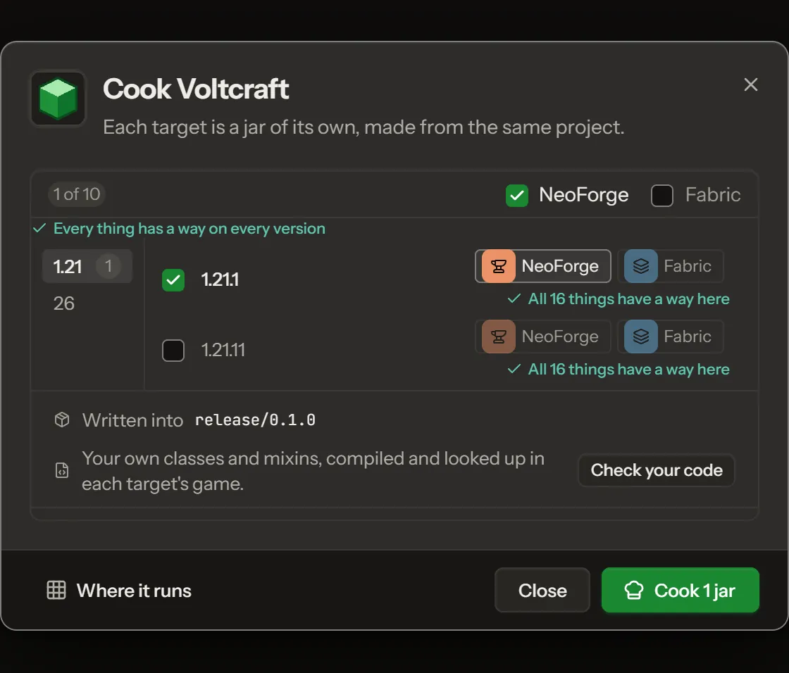

**Play** builds your mod and starts Minecraft with it. **Stop** closes the game again.

## Which version and loader

[Play](glossary.md#play) starts the version and [loader](glossary.md#loader) you pick in **Play on**. A project can have more than one. Pick another one there and press Play again. See [Versions and loaders](versions-and-loaders.md).

## The first start

The first time, Modryos downloads the game and its tools (about 1.7 GB) and builds your mod. That takes a few minutes. Later starts are much faster. You are asked to accept the Minecraft [EULA](glossary.md#eula) once, with **Accept and Play**.

## In the game

- Open the creative inventory and find your mod's own tab.
- Place your block and break it to see what drops.
- Open the mod list and look for your mod's name.

Change something in Modryos and press **Reload in the game**. Most changes show up without a restart. **Leave and rejoin the world** helps when one does not.

## The Cook window

[Cooking](glossary.md#cook) is how Modryos makes the mod file. Play does it for you. You can also open it with **File > Export > Make the mod file (.jar)**. It shows four steps:

1. **Write the project**
2. **Resolve what the game needs**
3. **Compile**
4. **Pack the file**

When it is done it tells you how many mod files it made. If something fails, the first red line says why. Fix it and press **Make again**.

If Play does not work, see [Troubleshooting](troubleshooting.md).
