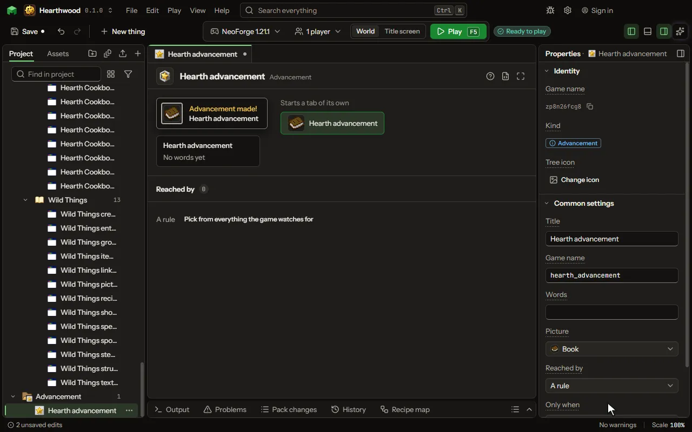

One of the game's own advancements: a goal with a toast, reached by an item, a kill or a rule.

## How to add it

- New thing > Screens and guides > Advancement

## What you can set

The main settings are below. The [Advancement](editor-advancement.md) editor lists every setting.

| Setting | What it does |
| --- | --- |
| Title | The title the game shows in its toast and its advancements screen. |
| Game name | The name the mod knows it by. Lowercase letters, numbers and underscores. |
| Words | The line under the title. |
| Picture | The item drawn beside its title. |
| Reached by | Having an item, killing a mob, a rule that grants it, or any of the things the game watches for. Choose one of: Having an item, Killing a mob, A rule, Anything the game watches for. |
| Item | The item a player must have. |
| Mob | The mob a player must kill, chosen from the list. |
| Needs | Whether a player must do all of these things, or any one of them. Choose one of: All of them, Any one of them. |

## What it becomes in the game

It is not part of the game itself: it describes another mod or a file, so it has no side to choose.

## What it works with

It points at: [Condition](editor-condition.md).

## Picture

## Related pages

- [Advancement](editor-advancement.md)
- [Templates and samples](templates-and-samples.md)
- [Glossary](glossary.md)
