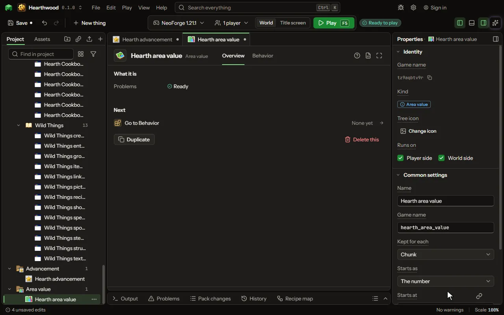

A number the world keeps by place, not by player or item: an aura in each chunk, an oil reservoir under it, radiation, a corruption that spreads, a pollution. Where it is kept, how it starts, spreads and comes back, and what happens as it rises or falls are its own; rules read, add, take and set it at any place.

## How to add it

- New thing > Blocks and items > Area value

## What you can set

The main settings are below. The [Area value](editor-areaValue.md) editor lists every setting.

| Setting | What it does |
| --- | --- |
| Name | What the value is called in the game, such as Aura or Oil. |
| Game name | The value's id in the game; the world saves it by this, and rules of another mod read it by it. |
| Kept for each | The area that holds one number: each chunk (16 by 16 blocks, all the way down), each square of chunks, each biome, or each dimension. Choose one of: Chunk, Square of chunks, Biome, Dimension, Block, Sealed room. |
| Square size | How many chunks across one square is. From 2 to 64 chunks. |
| Starts as | What a place has the first time it is asked of: the number below, a random number between the two (the same in the same world), or a smooth noise between them so nearby places are alike. Choose one of: The number, Random in a range, Smooth noise. |
| Starts at | What a place starts with, or the low end of its range. A formula of the place may stand in, such as its height. From -1000000000 to 1000000000. |
| Up to | The high end of the range a place starts in. From -1000000000 to 1000000000. |
| Chance of any | How many places in a hundred start with any at all; the rest start at the least, as most chunks hold no oil. From 0 to 100 percent. |
| Least | It never goes below this. From -1000000000 to 1000000000. |
| Most | It never goes above this; a HUD bar is full at it. From -1000000000 to 1000000000. |
| Comes back | How much it moves back by itself each second, as an aura recovers or radiation fades. Nought leaves it to the rules. A place far from everyone is caught up when next asked. From 0 to 1000000000 perSecond. |
| Comes back to | Where it settles: where the place started, its least, or its most. Choose one of: Where it started, Its least, Its most. |
| Spreads | How much of the difference with each area beside it moves across each second, in a hundred. Nought keeps each area to itself. From 0 to 100 percent. |
| Spreads how | Evens out, more flowing to less as an aura does; or grows outward from the areas at or above a level without them losing any, as a corruption does. Choose one of: Evens out, Grows outward. |
| Grows from | Only areas at or above this number grow into the areas beside them. From -1000000000 to 1000000000. |
| Blocks that push it | A block that raises or lowers the number round it, within a radius: a heater, a climatiser, a vent. Every such block near a place counts. The number is read at the place, not kept. Each row has: Block, Pushes by, Within, Reaches. |
| Blocks it turns | Where the number is high enough, blocks of a kind turn into another kind: grass into a dead grass, stone into a rot. A turn can need a block of another kind beside it, which makes it spread block to block. Each row has: Block that turns, Becomes, Only beside, Chance each try, Where it is at least, Each turn adds. |
| Vent blocks | A closed space with one of these blocks touching it keeps a number of its own, found by a fill from the place: air, pressure, heat. Open to the outside, too big, or with no vent, a place reads the outside number (the dimension's). Each row has: Block, Gives a second. |
| A new room starts at | What a room holds the first time it is sealed. Outside, the number starts as the settings above say, so an airless world can start at nought. From -1000000000 to 1000000000. |
| A step every | How often the blocks that hold it make, burn, cool, lose and pass it on: 20 ticks is a second. From 1 to 1200 ticks. |
| Blocks that hold it | Each kind of block that holds the number, such as a reactor's fuel cells, its casing and a heat sink, and how each passes it on, makes it, loses it and what happens at its limit. Each row has: Block, Passes on, Makes, Loses, Limit, At the limit, Turns into, Blast power, Lights at, Fuel let in, Lights when it holds, Uses up, Fuel let in by. |
| Redstone stops it | While a block of a build gets a redstone signal, the blocks joined to it make and burn nothing, as a reactor's shutdown lever does. Coolant and losing go on. |

## What it becomes in the game

It runs on the player's side of the game.

## What it works with

It does not point at other things.

## Picture

## Related pages

- [Area value](editor-areaValue.md)
- [Templates and samples](templates-and-samples.md)
- [Glossary](glossary.md)
