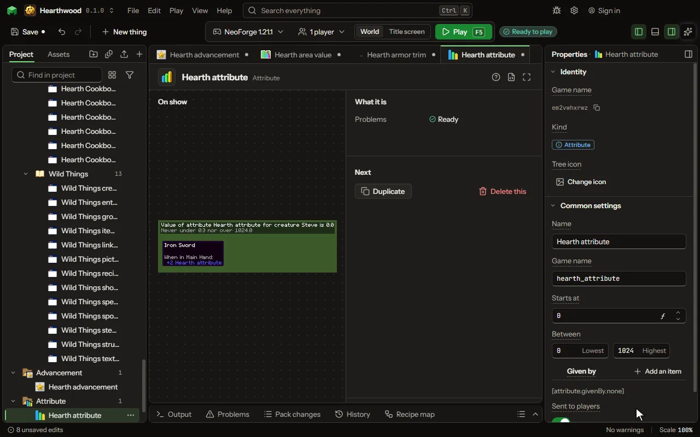

A number every living thing has, as luck and armor are.

## How to add it

- New thing > Mobs and models > Attribute

## What you can set

The main settings are below. The [Attribute](editor-attribute.md) editor lists every setting.

| Setting | What it does |
| --- | --- |
| Name | The attribute's name, as an item's tooltip shows it. |
| Game name | The attribute's name in the game, as the attribute command and a rule's words name it. |
| Starts at | What every living thing has until an item, an effect or a rule changes it. From -1000000 to 1000000. |
| Lowest | The lowest and the highest it can be, however much is added. From -1000000 to 1000000. |
| Highest | The lowest and the highest it can be, however much is added. From -1000000 to 1000000. |
| Given by | Items that give some of it while held or worn, as a sword gives attack damage. Each row has: Item, Gives, While. |

## What it becomes in the game

It is not part of the game itself: it describes another mod or a file, so it has no side to choose.

## What it works with

It does not point at other things.

## Picture

## Related pages

- [Attribute](editor-attribute.md)
- [Templates and samples](templates-and-samples.md)
- [Glossary](glossary.md)
