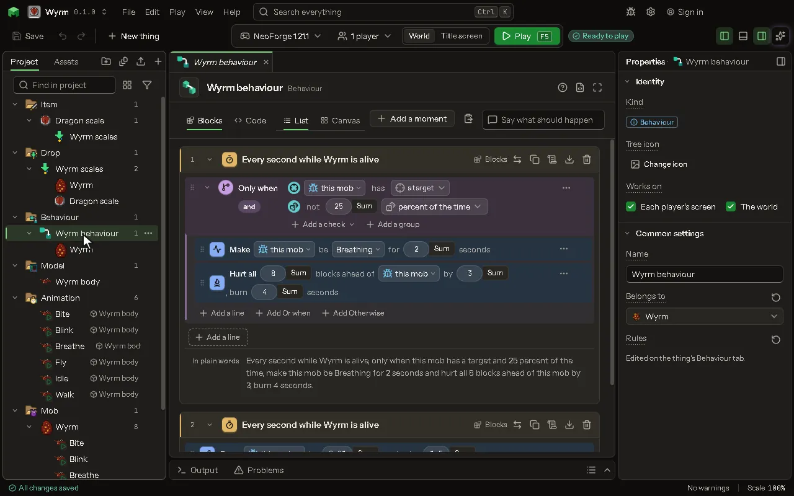

What happens when something happens: when this sword hits, set the target on fire.

## How to add it

- New thing > Logic and code > Behavior

## What you can set

The main settings are below. The [Behavior](editor-behaviour.md) editor lists every setting.

| Setting | What it does |
| --- | --- |
| Name | What to call this behaviour in the tree. |
| Belongs to | The block or item that does this. |
| Rules | What happens, and when. Edited on the thing's Behavior tab. |

## What it becomes in the game

It is written into the mod when you [Cook](glossary.md#cook) or press [Play](glossary.md#play).

## What it works with

It points at: [Block](editor-block.md), [Item](editor-item.md), [Mob](editor-creature.md), [Projectile](editor-projectile.md), [Thing](editor-thing.md), [Vehicle](editor-vehicle.md), [Spell](editor-spell.md), [Area value](editor-areaValue.md), [World event](editor-worldEvent.md), [Satellite](editor-satellite.md), [Space station](editor-spaceStation.md), [When fluids meet](editor-fluidReactions.md), [The player](editor-player.md), [Screen](editor-screen.md), [Command](editor-command.md), [Key binding](editor-keyBinding.md), [Skill tree](editor-skillTree.md), [Quests](editor-questBook.md), [Guide book](editor-guideBook.md), [Word of your own](editor-ownWord.md), [Chest menu](editor-chestMenu.md).

## An example

To make a sword set things on fire, see [Make a fire sword](make-a-fire-sword.md). It uses one rule, step by step.

## Picture

## Related pages

- [Behavior](editor-behaviour.md)
- [Templates and samples](templates-and-samples.md)
- [Glossary](glossary.md)
