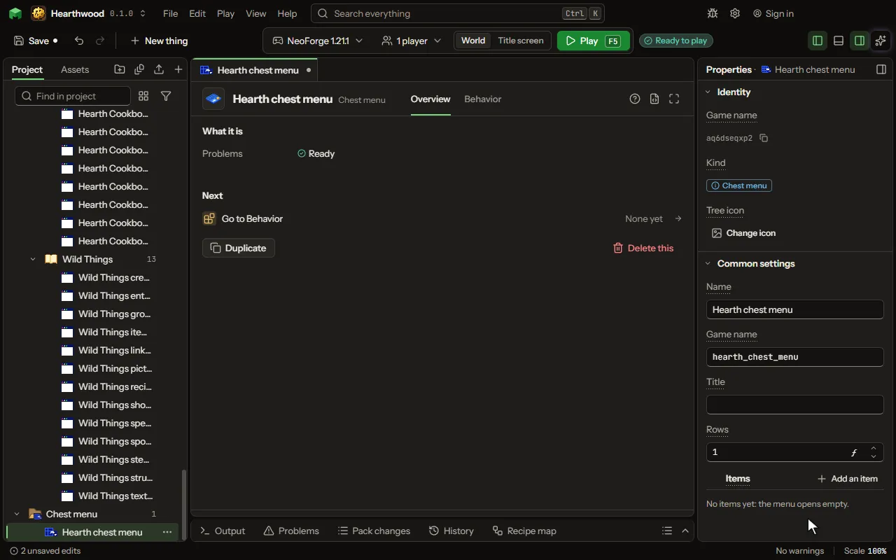

A chest's screen of items, one to six rows of nine, opened by a rule for one player; each item runs its own lines when clicked, and nothing can be taken from it. It works for players who did not install the mod: a welcome menu, a shop, a kit, a warp list.

## How to add it

- New thing > Screens and guides > Chest menu

## What you can set

The main settings are below. The [Chest menu](editor-chestMenu.md) editor lists every setting.

| Setting | What it does |
| --- | --- |
| Name | What the menu is called in the project. A rule opens it by this name. |
| Game name | The name the game knows the menu by inside the mod: lower case letters, digits and underscores. |
| Title | The words over the items, where a chest says Chest. Empty, the menu's own name. |
| Rows | How many rows of nine slots it has, from one to six, as a chest or a double chest has. From 1 to 6. |
| Items | What the menu shows, each in its slot with its name and its line. Each one clicked is a moment of its own on the Behavior tab. Each row has: Slot, Shown as, Name, Line, Closes the menu. |

## What it becomes in the game

It is not part of the game itself: it describes another mod or a file, so it has no side to choose.

## What it works with

It does not point at other things.

## Picture

## Related pages

- [Chest menu](editor-chestMenu.md)
- [Templates and samples](templates-and-samples.md)
- [Glossary](glossary.md)
