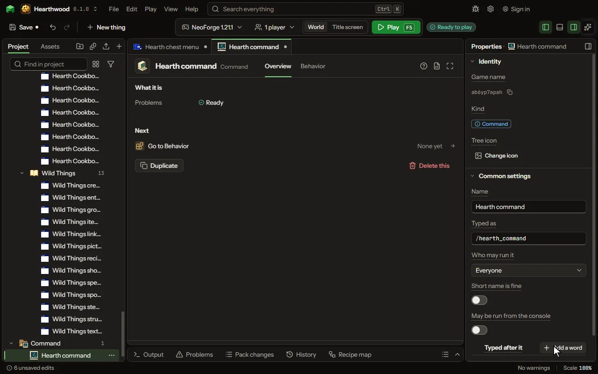

A command typed in chat with a slash, whose rules run when a player types it.

## How to add it

- New thing > Logic and code > Command

## What you can set

The main settings are below. The [Command](editor-command.md) editor lists every setting.

| Setting | What it does |
| --- | --- |
| Name | What you call it here. |
| Typed as | What a player types after the slash. Add a second word for a sub-command: goatapples reload becomes /goatapples reload. Lowercase letters, numbers and underscores. |
| Who may run it | Every player, or only operators. Choose one of: Everyone, Operators. |
| How trusted they must be | As the game counts it: 1 may pass spawn protection, 2 may use cheats and command blocks, 3 may kick and ban, 4 may stop the server. The server console is 4. From 1 to 4. |
| Short name is fine | Turn on to stop the warning that another mod may use the same first word. Players can always type /<your mod's game name> <command> instead. |
| May be run from the console | Typed in the server's own window, where nobody ran it: lines that need the player who ran it are left out then, and say so. |
| Typed after it | What a player types after the command, in order, each with a name the game shows and suggests it by. A rule of the command uses each by its name. Each row has: Called, Which is, Its choices. |

## What it becomes in the game

It is not part of the game itself: it describes another mod or a file, so it has no side to choose.

## What it works with

It does not point at other things.

## Picture

## Related pages

- [Command](editor-command.md)
- [Templates and samples](templates-and-samples.md)
- [Glossary](glossary.md)
