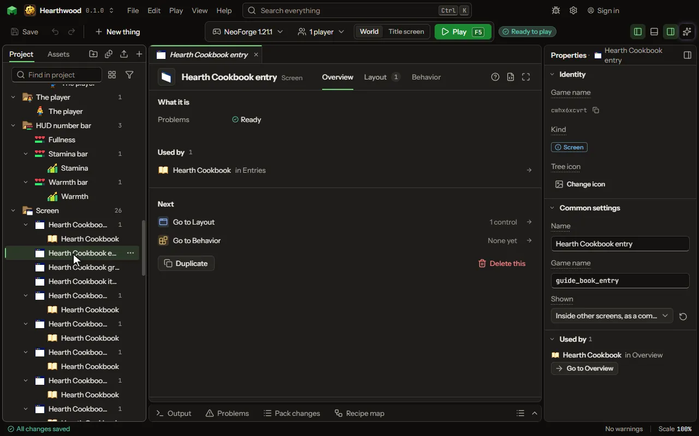

A small layout placed inside other screens as one control: a card, a row of a list, a header. Each place may change its words, colors, pictures and items, and changing the component changes them all.

## How to add it

- New thing > Screens and guides > Component

## What you can set

The main settings are below. The [Screen](editor-screen.md) editor lists every setting.

| Setting | What it does |
| --- | --- |
| Name | What you call it here, and the title the game shows. |
| Game name | The name the mod knows it by. Lowercase letters, numbers and underscores. |
| Shown | A screen a rule opens, drawn always over the game on the HUD with no background, or a component placed inside other screens. Choose one of: When a rule opens it, On the HUD, always, Inside other screens, as a component. |
| Pauses the game | Whether the game stops while it is open, in a world of one player. A world of several never stops. |
| Layout | Where everything on the screen is, laid out on the Layout tab. |

## What it becomes in the game

It is not part of the game itself: it describes another mod or a file, so it has no side to choose.

## What it works with

It does not point at other things.

Other things that open the same editor: [Screen](thing-screen.md), [HUD layout](thing-overlay.md).

## Picture

## Related pages

- [Screen](editor-screen.md)
- [Templates and samples](templates-and-samples.md)
- [Glossary](glossary.md)
