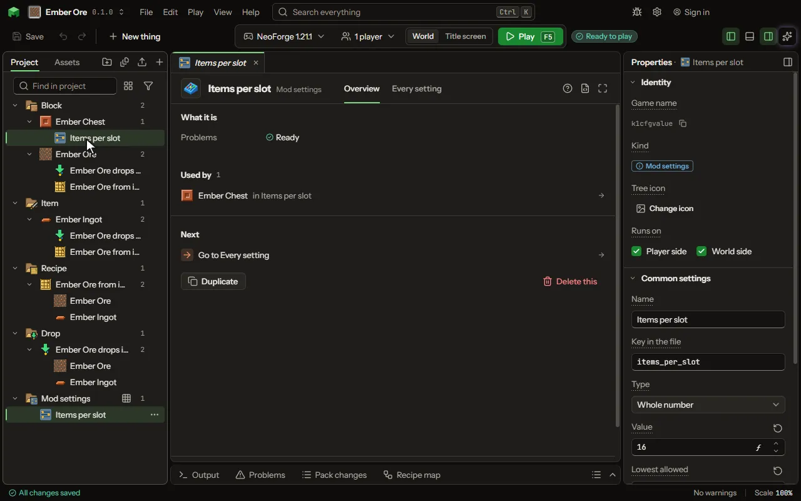

A setting players can change after the mod is built, in its config file: a number, on or off, one word out of a list, or a list of entries they edit.

## How to add it

- New thing > Logic and code > Mod settings

## What you can set

The main settings are below. The [Mod settings](editor-configValue.md) editor lists every setting.

| Setting | What it does |
| --- | --- |
| Name | What the setting is called in the config screen. |
| Key in the file | The name of the setting in the config file: letters, digits and underscores. |
| Type | What the setting holds: a whole number, a decimal such as a chance, on or off, one word out of a list you make, or a list of entries each with a few fields. Choose one of: Whole number, Decimal, On or off, A choice of words, A list of entries, Text. |
| Text | The words it holds until a player changes it. |
| Longest allowed | The most letters the config file accepts. 0 means any length. |
| Value | What it is until a player changes it. |
| Lowest allowed | The config file refuses anything below this. |
| Highest allowed | The config file refuses anything above this. |
| On | Whether it is on until a player changes it. |
| Words | The words a player may choose from: small letters, digits and _. |
| Chosen | The word it is until a player changes it. |
| Which file | Common is one file for everyone; client is each player's own; server lives with the world. Choose one of: Common, Client, Server. |
| Each entry has | The fields every entry of the list has, each with its name in the file and what it holds. Each row has: Field, Holds. |
| Entries | The entries the file starts with, one a line, each field as name=value with ; between them. The player adds, changes and takes away entries in the file. |

## What it becomes in the game

It is written into the mod when you Cook or press Play.

## What it works with

It does not point at other things.

## Picture

## Related pages

- [Mod settings](editor-configValue.md)
- [Templates and samples](templates-and-samples.md)
- [Glossary](glossary.md)
