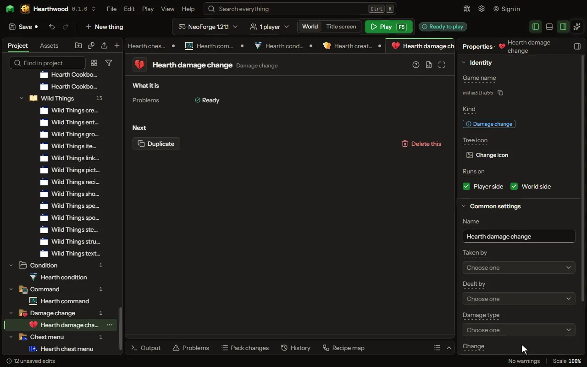

A hurt a living thing takes, changed or cancelled by who takes it, who deals it and what it is, on every game version, without code of yours inside the game's own.

## How to add it

- New thing > Mobs and models > Damage change

## What you can set

The main settings are below. The [Damage change](editor-damageChange.md) editor lists every setting.

| Setting | What it does |
| --- | --- |
| Name | What you call it in the project. |
| Taken by | What is hurt: choose a mob, or a group of them such as skeletons. Empty means any living thing. |
| Dealt by | What deals the hurt: choose a mob (a skeleton for its arrow), or a group of them. Empty means anything or nothing. |
| Damage type | What the hurt is, such as falling or fire, chosen from the list. Empty means any. |
| Change | What happens to the hurt. Changes run in the order of their elements; a hurt brought to 0 or less is not dealt. Choose one of: Multiply it, Add to it, Set it, Cancel it, Your class decides. |
| Amount | What it is multiplied by, added to it or set to, in health points (a heart is two). From -1000 to 1000. |
| Change class | Your class's full name. It implements the mod's Damages.Change: handed what is hurt, the damage source and the amount, it answers the amount dealt. |

## What it becomes in the game

It is written into the mod when you Cook or press Play.

## What it works with

It does not point at other things.

## Picture

## Related pages

- [Damage change](editor-damageChange.md)
- [Templates and samples](templates-and-samples.md)
- [Glossary](glossary.md)
