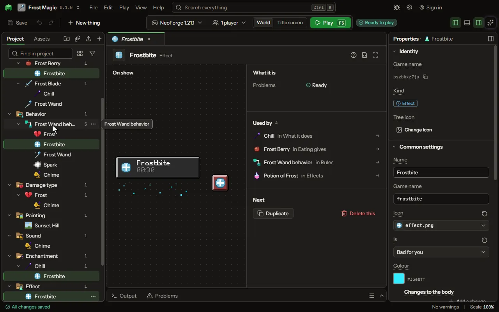

Something that happens to a mob for a while.

## How to add it

- New thing > Crafting and loot > Effect

## What you can set

The main settings are below. The [Effect](editor-effect.md) editor lists every setting.

| Setting | What it does |
| --- | --- |
| Name | The effect's name, as the inventory and a potion's lines show it. |
| Game name | The effect's name in the game, as /effect and another mod name it. |
| Icon | The picture the inventory and the corner of the screen show while it lasts. The game draws its own at eighteen pixels square. |
| Is | Good, bad or neither: the game draws a bad one's icon with a red edge, and milk takes every one away. Choose one of: Good for you, Bad for you, Neither. |
| Colour | The colour of its swirls round whoever has it, and of a potion of it. |
| Changes to the body | The body's numbers it changes while it lasts, more each level, as Speed makes a player a fifth faster a level. Each row has: Changes, By, As. |
| While it lasts | What it does by itself every so often, sooner each level, as Poison and Regeneration do. Choose one of: Nothing more, Hurts, Heals, Feeds, Sets on fire. |
| How much | Hearts of hurt or healing, points of food, or seconds of fire each time. From 0 to 1000. |
| Every | How often at level I; each level after does it twice as often. From 0.05 to 60 seconds. |

## What it becomes in the game

It is not part of the game itself: it describes another mod or a file, so it has no side to choose.

## What it works with

It does not point at other things.

## Picture

## Related pages

- [Effect](editor-effect.md)
- [Templates and samples](templates-and-samples.md)
- [Glossary](glossary.md)
