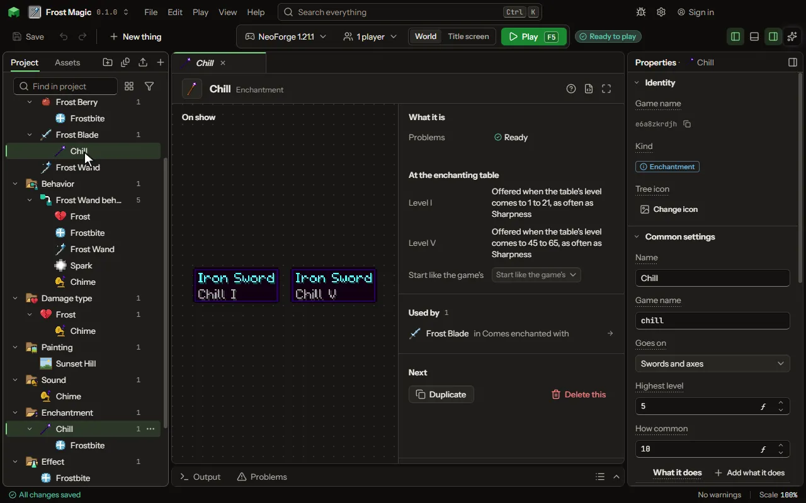

A power added to a tool or weapon.

## How to add it

- New thing > Crafting and loot > Enchantment

## What you can set

The main settings are below. The [Enchantment](editor-enchantment.md) editor lists every setting.

| Setting | What it does |
| --- | --- |
| Name | The enchantment's name, as its tooltip line shows it. |
| Game name | The enchantment's name in the game, as /enchant and a data pack name it. |
| Goes on | What an anvil puts it on: the game's own groups of tools, weapons and armour, which a mod's own join when they are of the same sort. Choose one of: Swords, Swords and axes, Weapons, Mining tools, Mining tools, for loot, Armour, Helmets, Chestplates, Leggings, Boots, Bows, Crossbows, Tridents, Maces, Fishing rods, Anything that wears out, Anything worn, Anything at all. |
| Highest level | The strongest it comes: Sharpness goes to V, Knockback to II. From 1 to 255. |
| How common | How often the table and loot pick it against the others: Sharpness and Protection are 10, Fire Aspect 2, Mending and Thorns 1. From 1 to 1024. |
| What it does | Each a thing the game does for it with no code, stronger each level. Each row has: Does, At level I, Each level more, Changes, Effect, For. |

## What it becomes in the game

It is not part of the game itself: it describes another mod or a file, so it has no side to choose.

## What it works with

It points at: [Effect](editor-effect.md).

## Picture

## Related pages

- [Enchantment](editor-enchantment.md)
- [Templates and samples](templates-and-samples.md)
- [Glossary](glossary.md)
