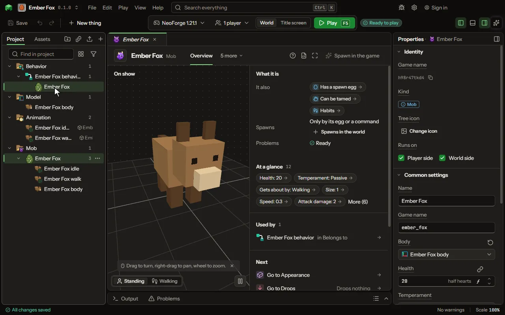

A mount that flies with its rider, beating its wings on each jump.

## How to add it

- New thing > Mobs and models > Flying mount

## What you can set

### Has a spawn egg

| Setting | What it does |
| --- | --- |
| Egg colour | The colour of the egg itself. |
| Spot colour | The colour of the spots on the egg. |

### Can be tamed

| Setting | What it does |
| --- | --- |
| Tamed by | What makes it a player's: an item given to it, riding it until it calms, or only a rule's words. Choose one of: Giving it an item, Riding it until it calms, Only a rule. |
| Tamed with | The item a player gives it, one each try. |
| Chance a try | How likely each item given, or each time it is ridden, tames it. From 1 to 100 percent. |
| Sits when told | Its owner's use makes it sit and stay, and stand again. |
| Follows owner | It keeps near its owner when it is not sitting. |
| Follows from | How far its owner may go before it comes after them. From 2 to 32 blocks. |
| Catches up | Left far behind, it appears beside its owner, as a tame wolf does. |
| Strikes back at its owner | Off, a tamed one never targets or attacks its owner or the owner's team, however it was hurt, as a wolf does not. |
| Defends owner | It attacks what hurts its owner and what its owner attacks. |
| Healed with | Foods its owner gives it to heal it. |

### Can be ridden

| Setting | What it does |
| --- | --- |
| Flies ridden | How it flies with a rider: the jump key rises, the sprint key (Ctrl) descends, forward goes where the rider looks, A and D turn it; hovering and flapping hold their height when no key is held, gliding sinks slowly. Choose one of: Does not fly, Glides, Hovers, Flaps, Its own way. |
| Climbs at | How fast it rises while its rider holds jump. From 0 to 40 blocks a second. |
| Sinks at | How fast it sinks in the air with nothing held. 0: it hovers. From 0 to 40 blocks a second. |
| Dives at | How fast it goes down while its rider holds the descend key. From 0 to 40 blocks a second. |
| In water | Floating keeps its rider's head up; swimming dives and rises where the rider looks, and the rider breathes. Choose one of: Floats, Swims under. |
| Needs a saddle | It can be ridden only once a saddle is put on it. |
| Saddle | The item used on it as its saddle. |
| Ridden by | Only its owner once it is tamed, or anyone. Choose one of: Its owner, Anyone. |
| Speed ridden | How fast it goes with a rider, times its own speed. From 0.1 to 5 times. |
| Flying speed | How fast it flies with a rider, times its own flying speed. From 0.1 to 5 times. |
| Jumps | How high it jumps on a full charge of the jump bar. From 0 to 8 blocks. |
| Seat height | How far above or below its back the rider sits; the back is found from the shape of its body. From -4 to 8 blocks. |
| A and D | Turning turns the creature and the rider's view with it, as a horse does; strafing moves it sideways and keeps it facing. Choose one of: Turn it, Strafe, Nothing. |
| Mouse look | Steering, the creature faces where the rider looks, as a vanilla horse does; looking only, the view turns on its own and the creature faces where A and D turned it. Choose one of: Steers it, Looks only. |
| W and S | Forward and back move it along its body; set to nothing, only the other keys move it. Choose one of: Move it, Nothing. |
| Jump key | Auto rises a flier or a swimmer and makes the others jump with the jump bar; or choose to rise, to jump, or nothing. Choose one of: Auto, Rise, Jump, Nothing. |
| Free up and down | A flier or a swimmer rises while the jump key is held, holds its height when nothing is held, and descends on the sprint key. Off, it goes up and down only where the rider looks. |
| Descend key | The key held to take a flier or a swimmer down (changed in the game's Controls); the sneak key always gets the rider off. Choose one of: Sprint key (Ctrl), Swap-hands key (F), None. |
| Rider on a tilt | Following, the rider leans with the seat's part of the body as it tilts (a dragon pitched in flight); upright, he stays level whatever the body does. First person stays level either way. Choose one of: Follows the seat, Stays upright. |
| Rider can hit it | A left click while riding never lands on the creature itself unless this is on. |
| Falls hurt | Off, neither the rider nor the creature takes fall damage while riding, and the rider none from the fall off its back. |
| Seat forward | How far forward of the middle of its back the rider sits; below zero is behind. From -4 to 4 blocks. |
| Turn speed | How fast A and D turn it, and the rider's view with it, in degrees a second. From 10 to 360 degrees a second. |
| Seats | How many ride it at once; the first steers. From 1 to 4. |

### Carries gear

| Setting | What it does |
| --- | --- |
| Bags | Rows of nine slots its owner opens by sneaking and using it; none for no bags. From 0 to 6. |
| Armour it wears | Items put on it as armour, each with what it gives and the look it wears with it. Each row has: Item, Armour, Toughness, Look. |

Every mob also has the settings on the [Mob](editor-creature.md) page.

## What it becomes in the game

It is added to the game, so a player needs your mod to see it.

It comes with these abilities already on: Has a spawn egg, Can be tamed, Can be ridden, Carries gear.

## What it works with

It points at: [Model](editor-model.md), [Sound](editor-sound.md), [Damage type](editor-damageType.md), [Code](editor-code.md).

Other things that open the same editor: [Mob](thing-creature.md), [Pet](thing-pet.md), [Mount](thing-mount.md), [Sea mount](thing-seaMount.md), [Boss](thing-boss.md).

## Picture

## Related pages

- [Mob](editor-creature.md)
- [Templates and samples](templates-and-samples.md)
- [Glossary](glossary.md)
