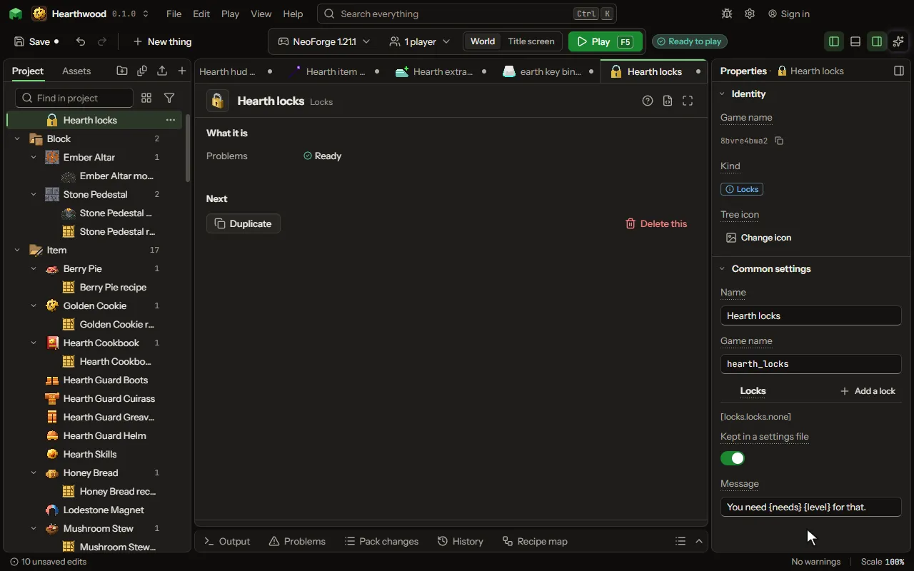

What a player may not use, wear, break, place, hit, enter or ride until they reach a skill level, a value or an advancement.

## How to add it

- New thing > Logic and code > Locks

## What you can set

The main settings are below. The [Locks](editor-locks.md) editor lists every setting.

| Setting | What it does |
| --- | --- |
| Name | The list's name. |
| Game name | Its name in the game; the settings file is named after it. |
| Locks | One lock a row: the act, what it is about (an item, a block, a mob, a dimension, or #a tag), and what opens it. Each row has: Stops, What, Opens with, Which, At least. |
| Kept in a settings file | The list is written to the game's config folder at the first start and read from there after, so a pack maker can change it. |

## What it becomes in the game

It is not part of the game itself: it describes another mod or a file, so it has no side to choose.

## What it works with

It does not point at other things.

## Picture

## Related pages

- [Locks](editor-locks.md)
- [Templates and samples](templates-and-samples.md)
- [Glossary](glossary.md)
