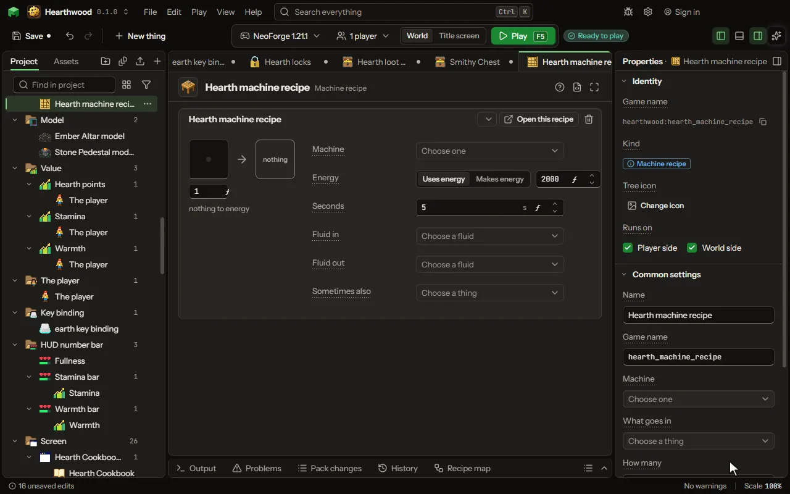

What one machine of yours turns into something else, and what it costs.

## How to add it

- New thing > Crafting and loot > Machine recipe

## What you can set

The main settings are below. The [Machine recipe](editor-machineRecipe.md) editor lists every setting.

| Setting | What it does |
| --- | --- |
| Name | What you call this recipe. Leave it empty and the card names itself from what goes in and what comes out. |
| Game name | The name the game files use for this recipe. |
| Machine | The block that runs it. Recipes name their machine, so adding one changes no block. |
| What goes in | The thing the machine takes from the slots it takes from. |
| How many | How many of it one operation uses. From 1 to 64. |
| What comes out | Leave this empty for a generator: it burns what goes in to nothing. |
| How many | How many come out of one operation. From 0 to 64. |
| Second thing in | A second thing that goes in with the first, as two metals make an alloy. Leave it empty for a machine that takes one thing. |
| How many of the second | How many of the second thing one operation uses. From 1 to 64. |
| Energy | Whether the machine spends energy on this or makes it. Choose one of: Uses energy, Makes energy. |
| How much energy | Over the whole operation, not each tick. It is spread evenly across the seconds below. From 0 to 1000000000. |
| Seconds | How long one operation takes. The game reads it while it runs, so it can come from somewhere else. From 1 to 3600 seconds. |
| More in and out | Any number of things more that go in or come out, beside the ones above: items, fluids or stocks of your own, each with how much and, coming out, how often. Each row has: Goes, What, Item, Fluid, Stock, Type, How much, How often, Tank. |
| Works only when | The recipe only works when this holds: at night, in a biome, in some weather, after an advancement, when a setting is on, or what is around the place it is made. Every row must hold. Each row has: When, Block, Value, Dimension, Weather, Name, Setting, At least, At most, Hours, At least, At most, Blocks away, Turned round. |

## What it becomes in the game

It is written into the mod when you [Cook](glossary.md#cook) or press [Play](glossary.md#play).

## What it works with

It points at: [Block](editor-block.md), [Custom kind](editor-matter.md), [Gene](editor-gene.md), [Area value](editor-areaValue.md), [Mod settings](editor-configValue.md).

## Picture

## Related pages

- [Machine recipe](editor-machineRecipe.md)
- [Templates and samples](templates-and-samples.md)
- [Glossary](glossary.md)
