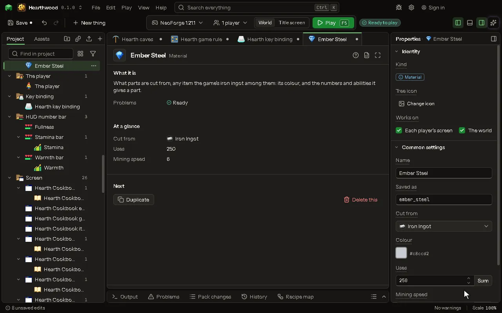

What parts are cut from, any item the game's iron ingot among them: its color, and the numbers and abilities it gives a part.

## How to add it

- New thing > Blocks and items > Material

## What you can set

The main settings are below. The [Material](editor-material.md) editor lists every setting.

| Setting | What it does |
| --- | --- |
| Name | What a player reads on a part cut from it. |
| Saved as | The name it is saved as in a part's data, which a piece of your own code reads. |
| Cut from | The item a player puts in the stonecutter to cut parts of this material, or a tag of them. |
| Color | The color a part cut from it wears, and the tool's part with it. |
| Uses | What a head of it lasts, as the game's pickaxe of it does: iron 250, diamond 1561. From 1 to 100000. |
| Mining speed | How fast a head of it mines: iron 6, gold 12. From 0.5 to 100. |
| Own stats | Stats of your own beside uses, speed and damage, such as Luck or Heat: a part gives its share of them to the tool, and a rule reads the tool's. Each row has: Stat, Amount. |
| Traits | Modifiers every tool with a part of this material carries, as if installed: their stat changes and their own rules. Two parts of it give the trait twice the level. Each row has: Modifier, Level a part. |

## What it becomes in the game

It is added to the game, so a player needs your mod to see it.

## What it works with

It points at: [Effect](editor-effect.md), [Item](editor-item.md).

## Picture

## Related pages

- [Material](editor-material.md)
- [Templates and samples](templates-and-samples.md)
- [Glossary](glossary.md)
