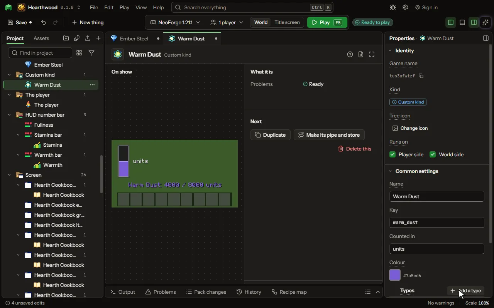

A matter of your own beside energy and fluid: a chemical, mana, heat, whatever your mod calls it. Blocks hold it in tanks, pipes and channels carry it, rules move it and moving parts show it.

## How to add it

- New thing > Machines and networks > Custom kind

## What you can set

The main settings are below. The [Custom kind](editor-matter.md) editor lists every setting.

| Setting | What it does |
| --- | --- |
| Name | What players call it, as it is shown. |
| Key | The name blocks keep it under, as the game keeps it with your mod's id in front. |
| Counted in | The word for one of it, shown after its amount: mana, units, degrees. |
| Colour | The colour it is drawn in where it shows. |
| Types | The types of it, each with a name and a colour: oxygen and hydrogen of a gas, fire and water of a magic essence. A tank of it takes any one type at a time, unless it names one. Each row has: Name, Key, Colour, Made of. |

## What it becomes in the game

It is written into the mod when you Cook or press Play.

## What it works with

It does not point at other things.

Other things that open the same editor: [Chemicals](thing-chemicals.md).

## Picture

## Related pages

- [Custom kind](editor-matter.md)
- [Templates and samples](templates-and-samples.md)
- [Glossary](glossary.md)
