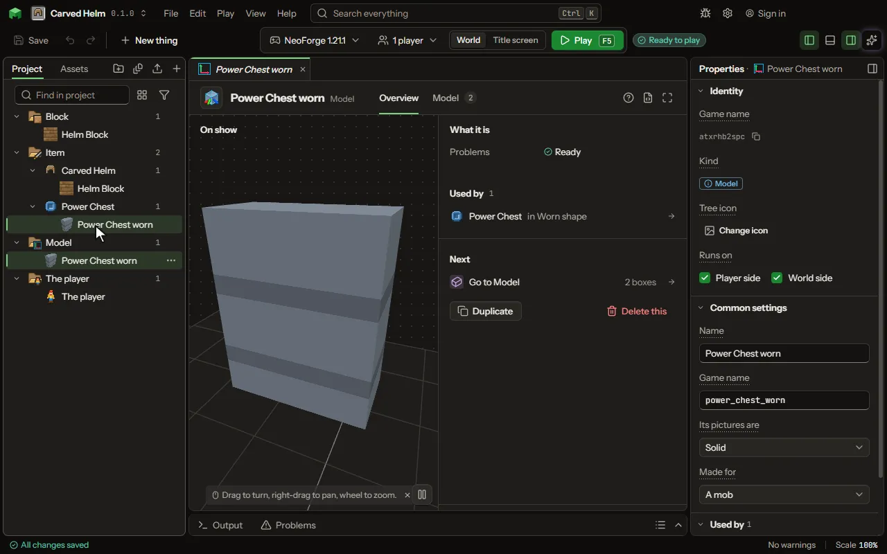

The shape of a block, item or mob, made from boxes.

## How to add it

- New thing > Mobs and models > Model

## What you can set

The main settings are below. The [Model](editor-model.md) editor lists every setting.

| Setting | What it does |
| --- | --- |
| Name | What this shape is called in the product. It is not shown in the game. |
| Game name | The name the game files use for this model, in small letters with no spaces. The Name above is only for you. |
| Shape | The boxes and groups this shape is made of. Open the Model tab to build it. |
| Its pictures are | How the game draws what is clear in the pictures. Solid ignores it. With holes leaves a clear pixel out, as the game's own glass does. See-through draws each pixel as clear as it was painted, so what is inside can be seen. Choose one of: Solid, With holes, See-through. |

## What it becomes in the game

It is written into the mod when you [Cook](glossary.md#cook) or press [Play](glossary.md#play).

## What it works with

It does not point at other things.

Other things that open the same editor: [Skin](thing-skin.md).

## Picture

## Related pages

- [Model](editor-model.md)
- [Templates and samples](templates-and-samples.md)
- [Glossary](glossary.md)
