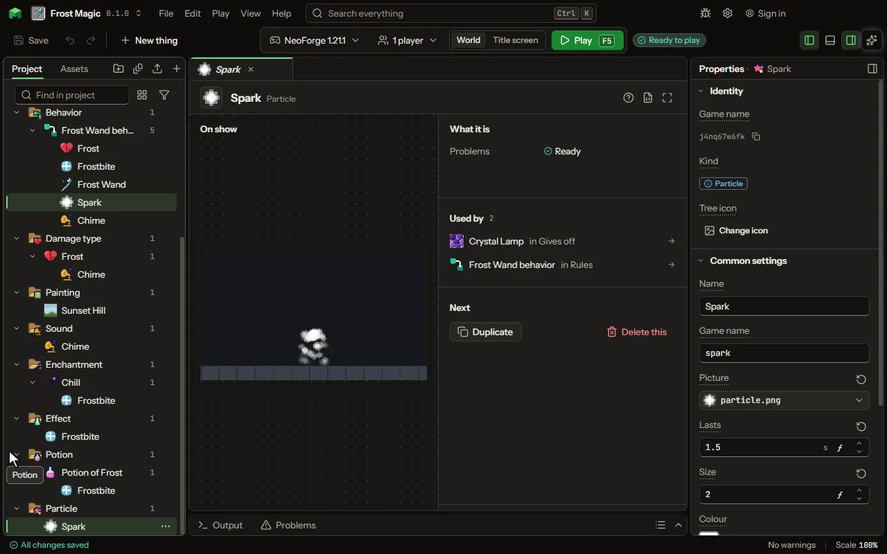

Sparks, smoke, dust and the like.

## How to add it

- New thing > Mobs and models > Particle

## What you can set

The main settings are below. The [Particle](editor-particle.md) editor lists every setting.

| Setting | What it does |
| --- | --- |
| Name | A name for you. Players see the particle, not its name. |
| Game name | The particle's name in the game, as /particle and another mod name it. |
| Picture | What one particle looks like; the game's own are eight pixels square. White takes the colour below as it is. |
| Lasts | How long one lives before it is gone. From 0.05 to 60 seconds. |
| Size | How large, where 1 is the game's ordinary particle, a fifth of a block. From 0.1 to 10. |
| Colour | The colour its picture is tinted: white leaves it as drawn. |
| Gravity | How fast it falls: 0 floats, 1 falls as a dropped thing does, below 0 rises. From -2 to 2. |
| Spreads | How fast it drifts away from where it appears, each way at random, in blocks a second. From 0 to 20 blocksPerSecond. |

## What it becomes in the game

It is not part of the game itself: it describes another mod or a file, so it has no side to choose.

## What it works with

It does not point at other things.

## Picture

## Related pages

- [Particle](editor-particle.md)
- [Templates and samples](templates-and-samples.md)
- [Glossary](glossary.md)
