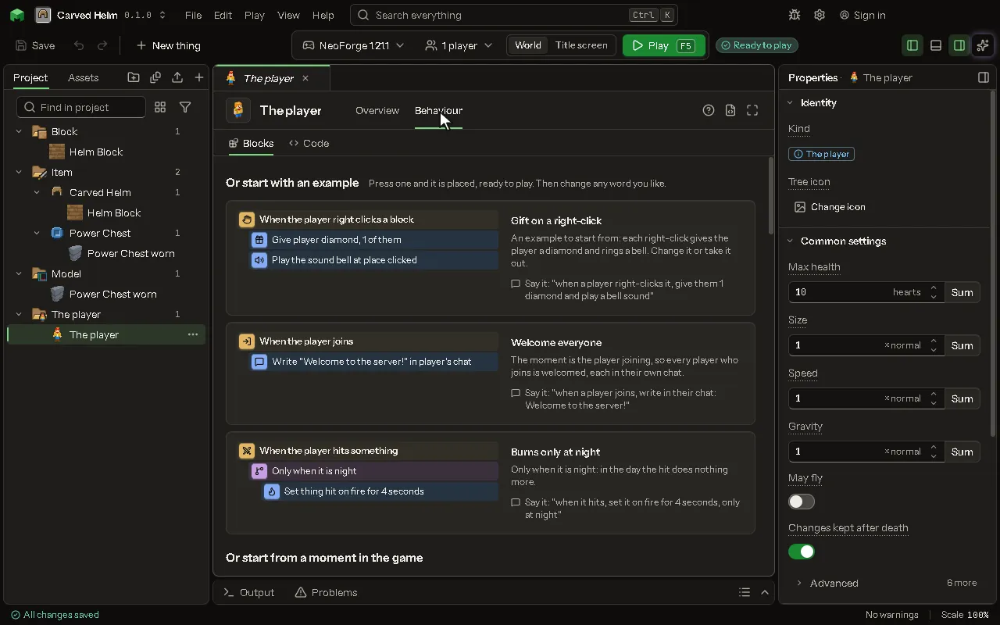

The game's own player: its body, and rules for its moments, such as when it eats, is hurt or joins.

## How to add it

- New thing > Mobs and models > The player

## What you can set

The main settings are below. The [The player](editor-player.md) editor lists every setting.

| Setting | What it does |
| --- | --- |
| Max health | How many hearts a player has; the game's own is 10. From 0.5 to 512 hearts. |
| Size | How big a player is; 1 is the game's own size. From 0.0625 to 16 normal. |
| Speed | How fast a player walks, as a share of the game's own; 1 is the game's own. From 0 to 10 normal. |
| Gravity | How hard a player falls, as a share of the game's own; 1 is the game's own, below 1 floats. From -10 to 10 normal. |
| May fly | A player may fly as in creative, in every game mode. |
| Changes kept after death | What rules changed of a player's body stays after it dies; off, it starts again from the numbers here. |
| Extra slots | Slots of your own beyond the game's, like rings or a back slot. They are kept with you, opened from a button on your inventory screen, and what is in them counts as worn. Each row has: Slot name, How many, Takes only, Look over, Starts showing. |

## What it becomes in the game

It is not part of the game itself: it describes another mod or a file, so it has no side to choose.

## What it works with

It does not point at other things.

## Picture

## Related pages

- [The player](editor-player.md)
- [Templates and samples](templates-and-samples.md)
- [Glossary](glossary.md)
