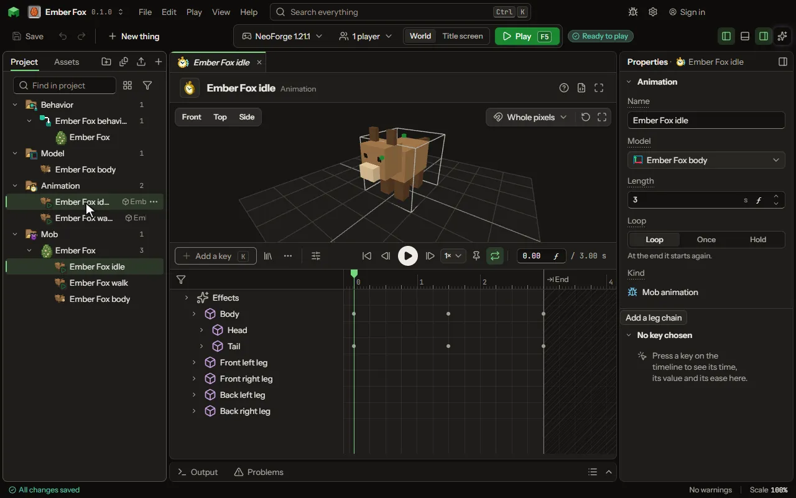

How a player's body moves for a moment, a wave or a bow, played on a player by a rule.

## How to add it

- New thing > Mobs and models > Player animation

## What you can set

The main settings are below. The [Animation](editor-animation.md) editor lists every setting.

| Setting | What it does |
| --- | --- |
| Name | A name for you, shown in the project and on a mob's Animations tab. Players never see it. |
| Model | The model whose parts this animation moves. It has to be one made for a mob, because the animation is kept by that model's parts. |
| Keys | How each part turns, moves and grows over time. Edited on the Animate tab. |

## What it becomes in the game

It is written into the mod when you Cook or press Play.

## What it works with

It points at: [Model](editor-model.md).

Other things that open the same editor: [Animation](thing-animation.md).

## Picture

## Related pages

- [Animation](editor-animation.md)
- [Templates and samples](templates-and-samples.md)
- [Glossary](glossary.md)
