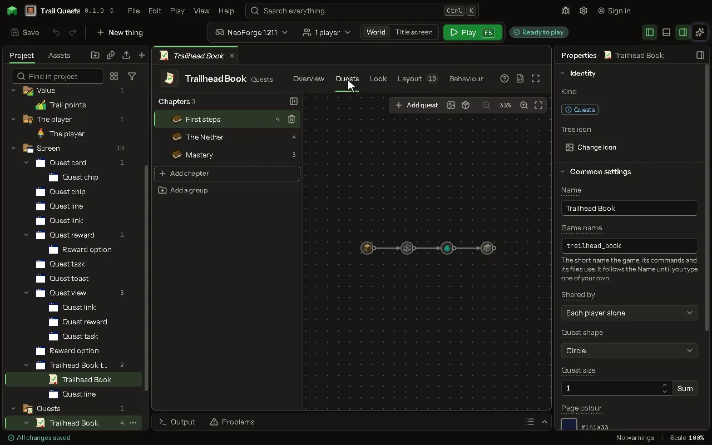

Chapters of quests a player finishes for rewards, read in a book of the mod's own, each quest placed on its chapter's page.

## How to add it

- New thing > Screens and guides > Quests

## What you can set

The main settings are below. The [Quests](editor-questBook.md) editor lists every setting.

| Setting | What it does |
| --- | --- |
| Name | What you call it here, and the book's title in the game. |
| Game name | The name the mod knows it by. Lowercase letters, numbers and underscores. |
| Shared by | Whose progress it is: each player's alone, or shared by the players of one team (the game's own teams). Choose one of: Each player alone, The player's team. |
| Quests | Its chapters and quests, laid out on the Quests tab. |
| Layout | Where everything on the screen is, laid out on the Layout tab. |

## What it becomes in the game

It is not part of the game itself: it describes another mod or a file, so it has no side to choose.

## What it works with

It points at: [Screen](editor-screen.md).

## Picture

## Related pages

- [Quests](editor-questBook.md)
- [Templates and samples](templates-and-samples.md)
- [Glossary](glossary.md)
