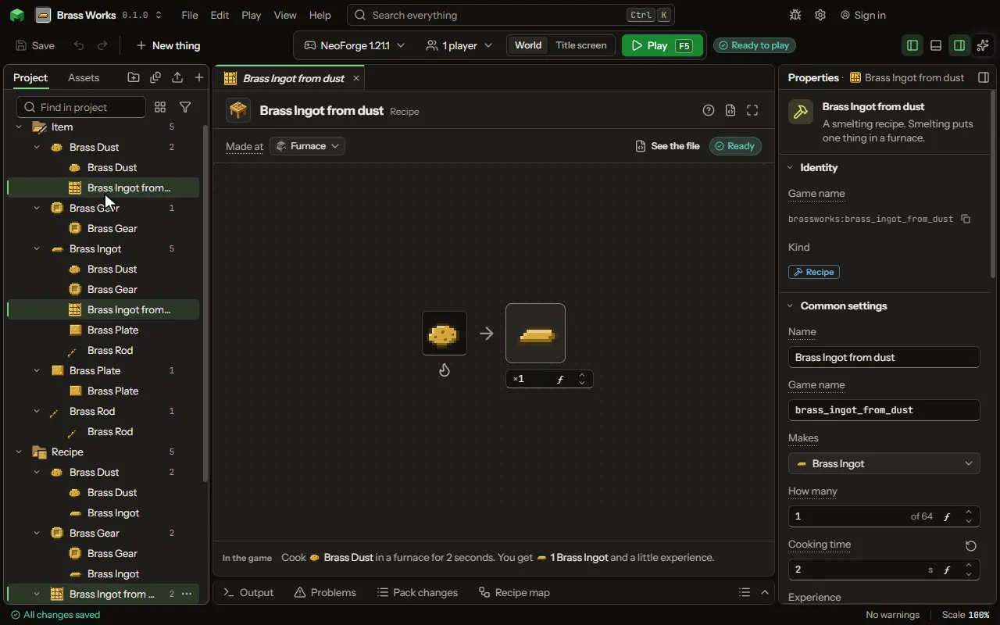

Make something in a crafting table, furnace, stonecutter or smithing table.

## How to add it

- New thing > Crafting and loot > Recipe

## What you can set

The main settings are below. The [Recipe](editor-recipe.md) editor lists every setting.

| Setting | What it does |
| --- | --- |
| Name | A name for you. Players never see it. |
| Recipe id | The file name inside the mod. Lowercase letters, digits and underscores. |
| Shape | Shaped keeps the things where you put them in the grid. Shapeless only cares which things are used. Smelting puts one thing in a furnace. Choose one of: Shaped, Shapeless, Smelting, Blasting, Smoking, Campfire, Stonecutting, Smithing, Trim, Transmute, Dye, Imbue, Brewing, Raw recipe. |
| Makes | What comes out of the crafting table. |
| How many | How many come out each time. From 1 to 64. |
| Works only when | The recipe only works when this holds: at night, in a biome, in some weather, after an advancement, when a setting is on, or what is around the place it is made. Every row must hold. Each row has: When, Block, Value, Dimension, Weather, Name, Setting, At least, At most, Hours, At least, At most, Blocks away, Turned round. |

## What it becomes in the game

It is written into the mod when you Cook or press Play.

## What it works with

It points at: [Potion](editor-potion.md), [Block](editor-block.md), [Area value](editor-areaValue.md), [Mod settings](editor-configValue.md).

## Picture

## Related pages

- [Recipe](editor-recipe.md)
- [Templates and samples](templates-and-samples.md)
- [Glossary](glossary.md)
