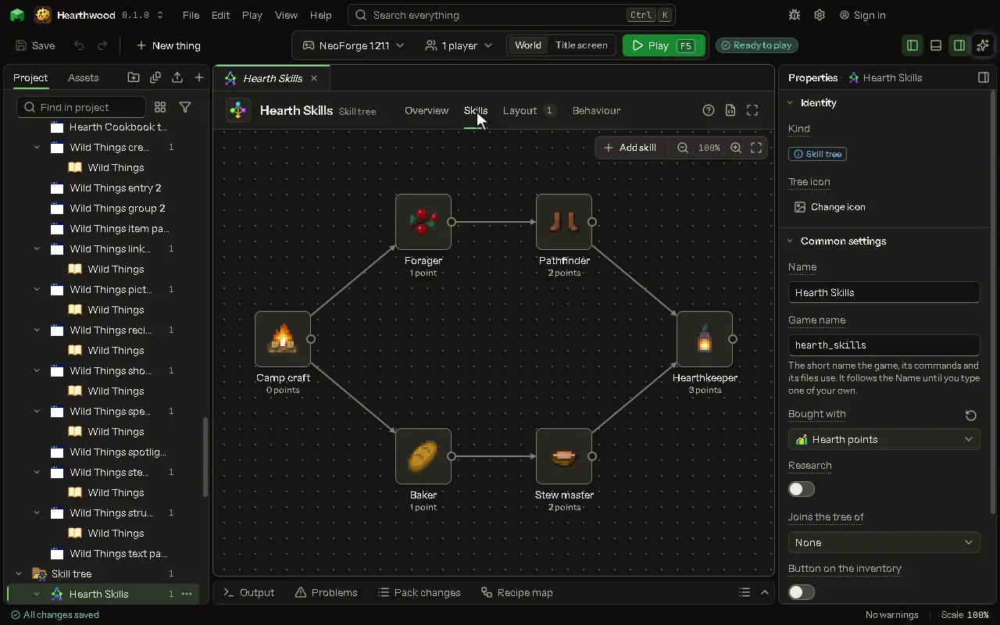

Studies a player researches with items, levels and time, each unlocking recipes and more.

## How to add it

- New thing > Screens and guides > Research

## What you can set

The main settings are below. The [Skill tree](editor-skillTree.md) editor lists every setting.

| Setting | What it does |
| --- | --- |
| Name | What you call it here, and the tree's title in the game. |
| Game name | The name the mod knows it by. Lowercase letters, numbers and underscores. |
| Bought with | The value of the player a skill costs points of. With none chosen, skills cost nothing. |
| Skills | Its skills, laid out on the Skills tab. |
| Layout | Where everything on the screen is, laid out on the Layout tab. |

## What it becomes in the game

It is not part of the game itself: it describes another mod or a file, so it has no side to choose.

## What it works with

It points at: [Value](editor-value.md).

Other things that open the same editor: [Skill tree](thing-skillTree.md).

## Picture

## Related pages

- [Skill tree](editor-skillTree.md)
- [Templates and samples](templates-and-samples.md)
- [Glossary](glossary.md)
