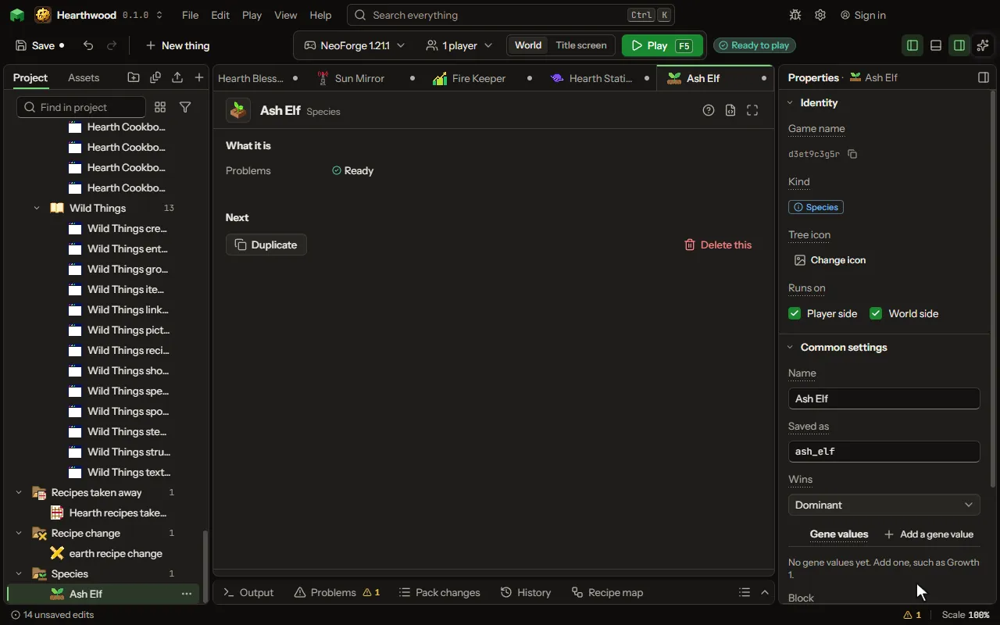

A kind of bee, plant or animal: the gene values it starts with, what it looks like as a block, an item or a mob, and which two species bred give it.

## How to add it

- New thing > Blocks and items > Species

## What you can set

The main settings are below. The [Species](editor-species.md) editor lists every setting.

| Setting | What it does |
| --- | --- |
| Name | What a player reads before the thing's name, such as Forest Bee. |
| Saved as | The name the species is kept under, and what rules call it. |
| Wins | When a thing carries two species, a dominant one shows over a recessive one. Choose one of: Dominant, Recessive. |
| Gene values | What each gene is in this species. A gene not listed starts as the gene says. Each row has: Gene, Value. |
| Block | The block this species grows as: what a crossing places, and a block that carries it. |
| Item | The item that carries this species, such as its seeds or its bee. |
| Comes from | Each line: two species bred give this one, by a chance, where its conditions hold. Each row has: First, Second, Chance, Only in, Near, Within, When, Takes the new species' genes. |
| Needs | What this species needs where it is, every line at once: a block near or under it, a biome, a time of day. A plant that lacks one does not grow, and rules can ask it. Each row has: Block, Within, Only in, When, Light at least, Light at most, Value, Value at least, Value at most. |

## What it becomes in the game

It runs on the player's side of the game.

## What it works with

It points at: [Gene](editor-gene.md), [Block](editor-block.md), [Item](editor-item.md), [Mob](editor-creature.md), [Area value](editor-areaValue.md).

## Picture

## Related pages

- [Species](editor-species.md)
- [Templates and samples](templates-and-samples.md)
- [Glossary](glossary.md)
