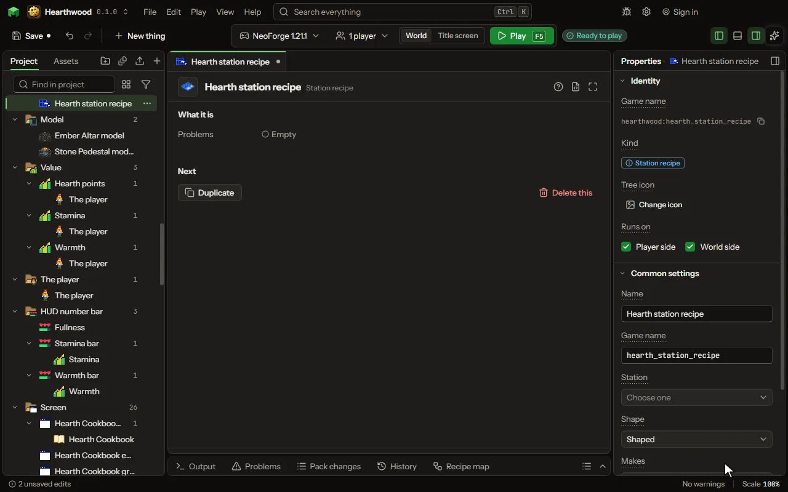

A recipe done on a station's own screen, with cells, tanks and energy.

## How to add it

- New thing > Crafting and loot > Station recipe

## What you can set

The main settings are below. The [Station recipe](editor-stationRecipe.md) editor lists every setting.

| Setting | What it does |
| --- | --- |
| Name | What you call this recipe. |
| Game name | The name the game files use for this recipe. |
| Station | The block whose screen it fills. Its Slot groups give the cells. |
| Shape | Shaped matches the pattern anywhere in a group; shapeless any cells. Choose one of: Shaped, Shapeless. |
| Cells | What each cell of the station's screen holds, by the cell's name. Each row has: Cell, Slot. |
| Makes | What comes out of the crafting table. |
| How many | How many come out each time. From 1 to 64. |
| Seconds | 0 crafts when the result is taken, as a crafting table does. From 0 to 3600 seconds. |
| How much energy | Energy it uses over the whole craft; 0 for none. From 0 to 1000000000. |
| More in and out | Any number of things more that go in or come out, beside the ones above: items, fluids or stocks of your own, each with how much and, coming out, how often. Each row has: Goes, What, Item, Fluid, Stock, Type, How much, How often, Tank. |
| Works only when | The recipe only works when this holds: at night, in a biome, in some weather, after an advancement, when a setting is on, or what is around the place it is made. Every row must hold. Each row has: When, Block, Value, Dimension, Weather, Name, Setting, At least, At most, Hours, At least, At most, Blocks away, Turned round. |

## What it becomes in the game

It is written into the mod when you Cook or press Play.

## What it works with

It points at: [Block](editor-block.md), [Custom kind](editor-matter.md), [Area value](editor-areaValue.md), [Mod settings](editor-configValue.md).

## Picture

## Related pages

- [Station recipe](editor-stationRecipe.md)
- [Templates and samples](templates-and-samples.md)
- [Glossary](glossary.md)
