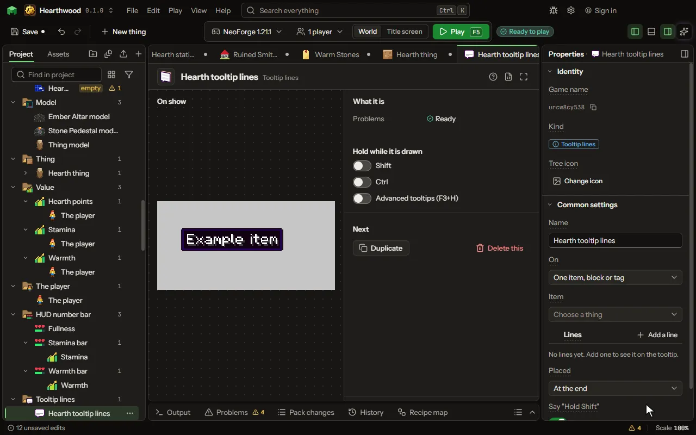

Lines added to the tooltip of any item or block, the mod's or the game's, or of every item, each filled in from the item's numbers and values and shown by its own condition.

## How to add it

- New thing > Screens and guides > Tooltip lines

## What you can set

The main settings are below. The [Tooltip lines](editor-tooltip.md) editor lists every setting.

| Setting | What it does |
| --- | --- |
| Name | What you call it here. |
| On | One item or block (or a tag of them), or every item in the game. Choose one of: One item, block or tag, Every item. |
| Item | The item, block or tag whose tooltip gets the lines: the mod's own or the game's. |
| Lines | Each line's words, color and when it shows. A line can say the item's numbers and a value it or the player keeps: see Words. Each row has: Words, Color, Shown, Value, Amount. |
| Placed | Right under the item's name, or at the end of its tooltip. Choose one of: At the end, Under the name. |

## What it becomes in the game

It is not part of the game itself: it describes another mod or a file, so it has no side to choose.

## What it works with

It points at: [Value](editor-value.md).

## Picture

## Related pages

- [Tooltip lines](editor-tooltip.md)
- [Templates and samples](templates-and-samples.md)
- [Glossary](glossary.md)
