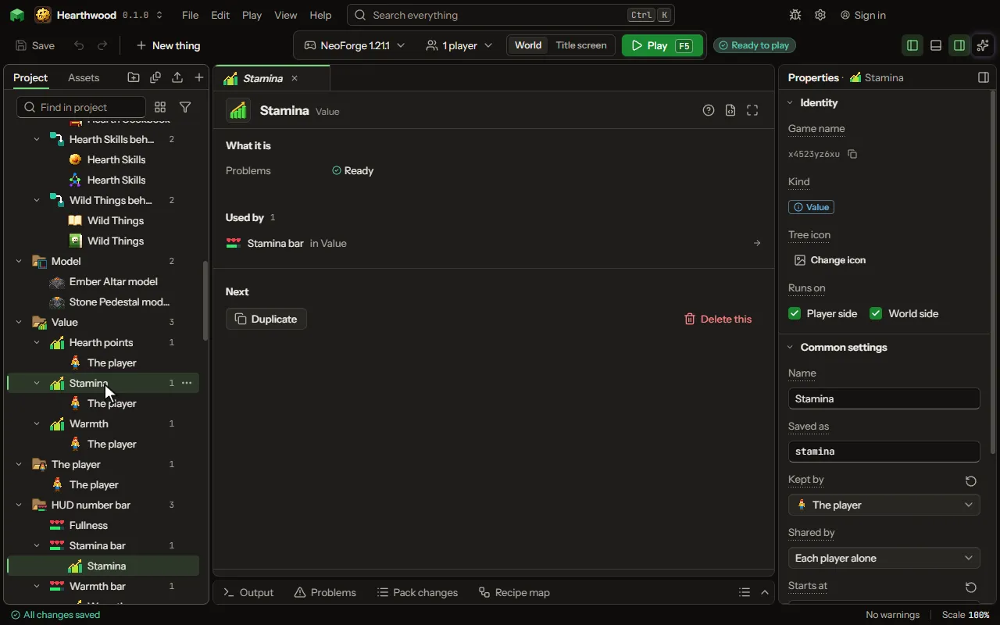

A number or a list kept by an item, the player, a team or the world: Energy, XP, Kills, the foods a player has eaten.

## How to add it

- New thing > Blocks and items > Value

## What you can set

The main settings are below. The [Value](editor-value.md) editor lists every setting.

| Setting | What it does |
| --- | --- |
| Name | What a player reads in the tooltip. |
| Saved as | The name it is saved as in the item's data, which a piece of your own code reads. |
| Kept by | The item that keeps it; each of that item a player holds keeps its own. |
| Shared by | Whose number it is: each player's alone, one shared by the player's team (the game's own teams), or one for the whole world. Choose one of: Each player alone, The player's team, The whole world. |
| Starts at | What a new one of the item has. From 0 to 1000000000. |
| Most | The most it can hold; adding past it stops there. From 1 to 1000000000. |
| Holds | A number, a list of items, or words. A list is such as the foods the player has eaten: its number is how many items it holds, and rules add to it, take from it and ask whether it has one. Words are what a player types into a screen's text field. A list is each player's own. Choose one of: A number, A list of items, Words. |
| Tooltip if in the list | A line on an item's tooltip while the list holds that item, such as Eaten. Empty says nothing. |
| Tooltip if not | A line on an item's tooltip while the list does not hold it, such as Not eaten yet. Empty says nothing. |
| Tooltip on | Which items carry the line: foods only, or every item. Choose one of: Foods, Every item. |
| Comes back | How much it gains by itself each second, toward its most (a mana that refills); less than nought drains it. Nought leaves it to the rules. From -1000000000 to 1000000000 perSecond. |
| Shown | Where a player sees it: a bar under the item's picture, a line of its tooltip, both, or nowhere. Choose one of: Bar and tooltip, Bar, Tooltip, Nowhere. |
| Bar color | The color of its bar under the item's picture. |

## What it becomes in the game

It is added to the game, so a player needs your mod to see it.

## What it works with

It points at: [Item](editor-item.md), [The player](editor-player.md).

## Picture

## Related pages

- [Value](editor-value.md)
- [Templates and samples](templates-and-samples.md)
- [Glossary](glossary.md)
