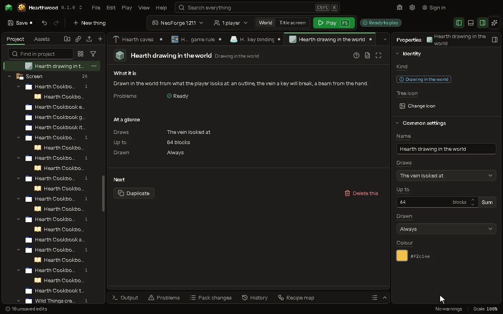

Drawn in the world from what the player looks at: an outline, the vein a key will break, a beam from the hand.

## How to add it

- New thing > Screens and guides > Drawing in the world

## What you can set

The main settings are below. The [Drawing in the world](editor-worldDraw.md) editor lists every setting.

| Setting | What it does |
| --- | --- |
| Name | What you call it here. |
| Draws | What it draws each frame, from the block under the crosshair: the blocks of its kind joined to it (a vein, as Break the blocks joined counts them), that block alone, or a beam from the player's hand to where the crosshair meets something. Choose one of: The vein looked at, The block looked at, A beam from the hand. |
| Up to | The most blocks it outlines, counted outward from the one looked at, as Break the blocks joined counts them. From 1 to 1024 blocks. |
| Drawn | When it is drawn: all the time, while the player holds down a key of the mod's, or while the player holds an item of the mod's in the main hand. Choose one of: Always, While a key is held down, While an item is in the hand. |
| Key | The key of the mod's that draws it while held down. |
| Item | The item of the mod's that draws it while in the main hand. |
| Color | The color it is drawn in. |

## What it becomes in the game

It is not part of the game itself: it describes another mod or a file, so it has no side to choose.

## What it works with

It points at: [Key binding](editor-keyBinding.md), [Item](editor-item.md).

## Picture

## Related pages

- [Drawing in the world](editor-worldDraw.md)
- [Templates and samples](templates-and-samples.md)
- [Glossary](glossary.md)
