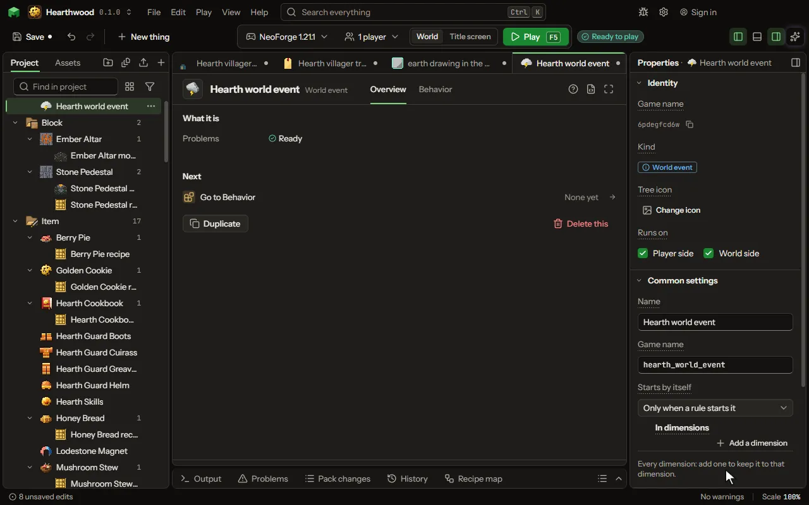

Something that happens to a whole dimension for a while: a blood sky, a fog bank, an aurora, a rift. When it starts, how long it lasts, what the players see and what it does round them. Rules start it, end it and ask whether it is on.

## How to add it

- New thing > Blocks and items > World event

## What you can set

The main settings are below. The [World event](editor-worldEvent.md) editor lists every setting.

| Setting | What it does |
| --- | --- |
| Name | The name of the event, as you and your players know it. |
| Game name | The event's name inside the game files. Lower case letters, numbers and underscores. |
| Starts by itself | When the game rolls the chance below: at nightfall, midnight, sunrise or noon each day, or every minute. Never leaves it to your rules. Choose one of: At nightfall, At midnight, At sunrise, At noon, Every minute, Only when a rule starts it. |
| Chance each time | How likely it is to start each time the game rolls for it. From 0 to 100 percent. |
| In dimensions | The dimensions where it can start by itself. Empty means every dimension. Each row has: Dimension. |
| Lasts | How many seconds it lasts. A rule can start it for another length. From 1 to 86400 seconds. |
| Sky tint | The colour laid over the sky half of every screen in the dimension while it lasts. |
| Sky tint strength | How strong the tint is at its fullest, strongest at the top. Nought leaves the sky alone. From 0 to 100 percent. |
| Fog colour | The colour laid over the whole screen while it lasts. |
| Fog thickness | How thick the fog is at its fullest. Nought brings no fog. It fades in the last five seconds. From 0 to 100 percent. |
| Particles round each player | Particles thrown round every player in the dimension each second while it lasts: ash, spores, rain of sparks. Each row has: Particle, Each second, Spread over. |
| Pushes area values | An area value it adds to each second at every player's place while it lasts: a corruption rising, a rift charging. Each row has: Area value, Each second. |
| Calls mobs | Mobs that appear near each player while it lasts, so a night brings its own creatures. Each row has: Mob, Chance each second, No more than, Appears. |

## What it becomes in the game

It runs on the player's side of the game.

## What it works with

It points at: [Particle](editor-particle.md), [Area value](editor-areaValue.md), [Mob](editor-creature.md).

## Picture

## Related pages

- [World event](editor-worldEvent.md)
- [Templates and samples](templates-and-samples.md)
- [Glossary](glossary.md)
