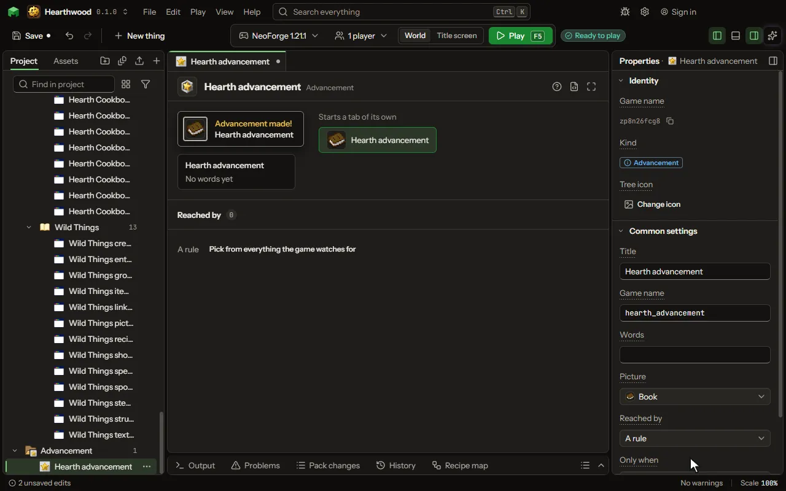

# Advancement editor

One of the game's own advancements: a goal with a toast, reached by an item, a kill or a rule.

## How to add it

- New thing > Screens and guides > Advancement

## What you can set

| Setting | What it does |
| --- | --- |
| Title | The title the game shows in its toast and its advancements screen. |
| Game name | The name the mod knows it by. Lowercase letters, numbers and underscores. |
| Words | The line under the title. |
| Picture | The item drawn beside its title. |
| Reached by | Having an item, killing a mob, a rule that grants it, or any of the things the game watches for. Choose one of: Having an item, Killing a mob, A rule, Anything the game watches for. |
| Item | The item a player must have. |
| Mob | The mob a player must kill, chosen from the list. |
| Needs | Whether a player must do all of these things, or any one of them. Choose one of: All of them, Any one of them. |
| Things to do | What the player does to reach this, each from the game's own list. |
| Only when | A condition the player must pass for this to count. |
| After | The advancement it follows in the advancements screen. With none, it starts a tab of its own. |
| Frame | How its picture is framed: a task, a goal or a challenge. Choose one of: Task, Goal, Challenge. |
| Experience | The experience a player is given on reaching it. From 0 to 100000. |
| Said in chat | Whether the chat says who reached it. |
| Hidden until reached | Whether it stays out of the advancements screen until a player reaches it. |

## What it becomes in the game

It is not part of the game itself: it describes another mod or a file, so it has no side to choose.

## What it works with

It points at: [Condition](editor-condition.md).

## Picture

## Related pages

- [Advancement](thing-advancement.md)
- [Glossary](glossary.md)
